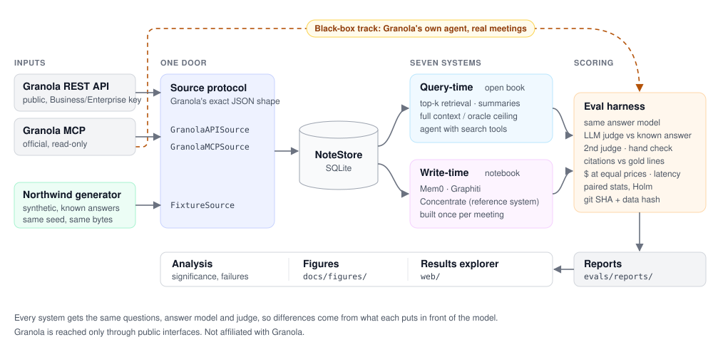

# Hindsight: an outside-in benchmark for agent memory over meeting notes

**When an agent asks "what did we decide about pricing, and who owns the follow-up?", should it search transcripts on the spot, or read a memory built ahead of time?**
Hindsight measures this from the outside, using only Granola's public note format, API and MCP: shareable synthetic meetings with known answers, plus a black-box kit for testing any meeting MCP on your own meetings.

*Independent research prototype; [not affiliated with Granola](#not-affiliated-with-granola).*


## What we found

- **On real meetings, Granola's own agent clearly beat our memory system: 92% vs 59%.** These are 39 LLM-drafted, owner-approved questions over the author's 4 real meetings. n is small and it's one person's data, but paired by question the gap is 14 to 1 (sign test p ≈ 0.001). Concentrate scored 0% on "who said X" ([`REAL_SLICE`](docs/results/REAL_SLICE.md)).
- **On the synthetic benchmark, it's a tie, at lower cost.** Concentrate (92%), an agent over search + transcripts (90%) and top-k retrieval (88%) are statistically tied on 120 held-out questions. Concentrate is about 3.5× cheaper per question than the agent at equal prices (about 2× against an agent with prompt caching), and only comes out ahead once a set of meetings gets more than about 50 questions, counting ingest. The synthetic questions follow the same kind of facts Concentrate's extractor keeps, so they couldn't show the real-meeting failure.
- **A hybrid looks promising, but it's a dev result, not a claim.** Adding a transcript fallback (read transcript passages when the memory can't answer) took Concentrate from 12/22 to 20/22 on the real questions it reached before the budget cap, fixing 8 and breaking none (p = 0.008). Granola's agent scored 19/22 on the same questions. Those questions motivated the design; the real test needs fresh questions written after the design freeze ([`fallback`](docs/systems/concentrate/fallback.md)).
- **What transcript deletion costs on real meetings (dev result).** Granola already lets users auto-delete transcripts, after which chat works from notes only, and its own help page says "Chat quality will be degraded". We simulated that through Granola's public MCP on the 47 real dev questions:
  - with transcripts, Granola's agent scored 89%;
  - with notes only, the same questions scored 57% (17 lost, 2 gained, p = 0.001);
  - adding our fact layer to the notes recovered little: 66%, and not reliably;
  - letting the system read the transcript when the notes fall short recovered most of the gap: 87%.

  On synthetic questions the fact layer looked much stronger (notes-only 64% → 88%), again because those questions target extracted facts. Our reading: the cost of deletion is real and falls on detail questions, and what recovers it is keeping transcripts reachable, not a fact layer alone. These are dev questions, the notes-only condition uses our answering model rather than Granola's own degraded chat, and n is small ([`DELETION_SIM`](docs/benchmark/DELETION_SIM.md), [`RETIREMENT`](docs/results/RETIREMENT.md)).

## Why an outside benchmark

Everything here is built **only on public interfaces** and **data anyone can share**. That's the point: it gives Granola things its internal data can't.

1. **Shareable ground truth.** Real customer meetings are private and have no known answers. Northwind's synthetic meetings are in Granola's exact format, privacy-free, and every answer is known by construction.
2. **Comparability.** Any system can run on the same questions: other meeting tools, generic memory products (Mem0, Graphiti, Zep) and plain frontier models, not just Granola against Granola.
3. **The outside-in view.** External agents (Claude, ChatGPT) reach Granola only through its MCP. A black-box test of the MCP measures what those agents actually experience: latency, answer quality and failure modes.
4. **Independence.** Results from an outside party are more credible than a vendor's own claims.

This is also why **Concentrate, the memory system built here, is a reference system, not a product pitch.** Granola can build a better one internally; it's here to show what a precomputed memory gains and loses. Our re-implementation of Granola's agent (b3) is just a generic agentic-retrieval baseline; the real Granola agent is only ever tested as a black box. We make no claims about Granola internals.

## What we measure

There is deliberately **no single score**: one number hides trade-offs, such as a system that is cheap and wrong. Every metric is defined, with a worked example, in [`docs/benchmark/METRICS.md`](docs/benchmark/METRICS.md).

| | Dimension | Question it answers | Main metrics | Status |
|---|---|---|---|---|
| A | Correctness | Is the answer right? | accuracy with 95% bootstrap CI, exact-match cross-check | ✅ |
| B | Judge reliability | Can we trust the grader? | second-judge agreement, Cohen's κ, human hand check | ◐ human check not done yet |
| C | Grounding | Can it show its work? | citation precision/recall vs gold lines, hallucination rate, source recall | ◐ citations only |
| D | Knowing what it doesn't know | Does it abstain, and know when it's likely wrong? | abstention on unanswerable questions, calibration | ◐ abstention only |
| E | Efficiency | What does it cost, and how fast? | $/question at equal prices, ingest cost and break-even, latency p50/p95 | ✅ |
| F | Robustness | Does it hold up when conditions change? | by question type, corpus size, transcript realism, transcript deletion, synthetic vs real | ◐ partial |

Comparisons are paired (McNemar, paired bootstrap) with Holm correction, so a tie is never reported as a win.

## Two tracks

| | Public track (synthetic) | Black-box track (bring your own meetings) |
|---|---|---|
| **Who it's for** | any system that can ingest a corpus: Mem0, Graphiti, Concentrate, RAG, long-context models, any vendor willing to load it | products that can't load our corpus, such as Granola or any meeting tool with an MCP |
| **Data** | *Northwind*: a synthetic company, 184 meetings, 296 questions (90 dev / 206 test), nine categories such as who-said-what without speaker labels, which of three Sams, a price *as of* a given week, and whether a commitment was kept | the user's own meetings and questions, through the product's public MCP; everything stays local |
| **Answers known by** | construction: the world is generated first | the meeting owner approving each gold answer |
| **Run with** | `concentrate synth`, `concentrate eval` | `concentrate real-kit`, `concentrate real-slice` |
| **Docs** | [`benchmark/DESIGN.md`](docs/benchmark/DESIGN.md) | [`results/REAL_SLICE.md`](docs/results/REAL_SLICE.md) |

Existing memory benchmarks (LongMemEval, LoCoMo, BEAM, RealMem) are chat logs; we found none built on meetings.

**What a read-only probe of Granola's live MCP found (2026-11-02).** Granola's MCP is now an agent (`query_granola_meetings` searches, reads and cites), so the baseline to beat is per-query agentic retrieval, not naive top-k. On a handful of real meetings we still saw a cross-meeting identity miss (a teammate found in one meeting, missed in another where the invite showed only their email handle), commitments owned by "Unidentified speaker" when one microphone was shared in person, and summary-first answers that cost extra transcript round-trips for exact details. These are reproducible observations, not a measured error rate ([`PROBE_2026-11-02`](docs/archive/PROBE_2026-11-02.md)).

## Results

<!-- RESULTS:START -->
### 1. Real meetings: Granola's agent vs Concentrate ([`docs/results/REAL_SLICE.md`](docs/results/REAL_SLICE.md))

| System | Accuracy [95% CI] | n | Median latency |
|---|---|---|---|
| **Granola's agent** (`query_granola_meetings`, live) | **92% [82, 100]** | 39 | 7.9 s |
| Top-k retrieval (k = 1 of 4 meetings) | 77% [64, 90] | 39 ¹ | 3.3 s |
| **Concentrate** | **59% [44, 74]** | 39 | 4.2 s |

- The questions are about the author's 4 real meetings. They were LLM-drafted and the owner approved the gold answers in bulk, with 0 edits.
- A second judge agreed on 97% of verdicts.
- 8 of the 47 questions weren't run because of budget: all 6 unanswerable and 2 temporal.
- By category, Concentrate scores **0% on "who said X"** (Granola 88%) but **leads on "what changed"** (100% vs 83%).
- n is small and the data comes from one person, but the gap is far outside the error bars. Paired by question, Granola's agent was right where Concentrate was wrong 14 times, and the reverse once (sign test p ≈ 0.001).
- ¹ Top-k also ran on all 47 questions: 81% [68, 91], including 6 of 6 unanswerable.
- **Follow-up: a transcript fallback (dev result, not a claim).** When Concentrate's facts can't answer, it now retrieves transcript passages and answers again. On the 22 real questions it reached before hitting the budget cap, it rose from 12/22 to 20/22, fixing 8 and breaking none (p = 0.008). On the same questions Granola's agent scored 19/22. These questions motivated the design, so this is a dev result. The real test needs fresh questions written after the design freeze ([`docs/systems/concentrate/fallback.md`](docs/systems/concentrate/fallback.md)). It's off by default.

### 2. Synthetic benchmark: 120 held-out test questions, 7 systems (2026-11-02)

Northwind-XL v1, 184 meetings, same answer model (Opus 5.5) and judge for all. Sources: [`report`](evals/reports/20261103T002456Z.md) · [`significance`](evals/reports/20261103T002456Z.analysis.md) · [`red-team audit`](docs/results/RED_TEAM.md).

| System | Accuracy [95% CI] | $ / question ¹ | p50 latency | One-off ingest |
|---|---|---|---|---|
| Oracle (reads only the gold meetings; a ceiling) | 95% [91, 98] | 0.082 | 4.5 s | — |
| **Concentrate** | **92% [86, 96]** | **0.040** | 3.8 s ² | $5 |
| Agent over search + transcripts (our re-implementation) | 90% [84, 95] | 0.137 (≈0.07–0.08 with prompt caching ³) | 13.2 s | — |
| Top-k hybrid retrieval (k = 10 meetings) | 88% [82, 94] | 0.328 | 6.4 s ² | — |
| Mem0 (our default wiring) | 81% [73, 88] | 0.017 | 3.3 s | $17 |
| Graphiti (our default wiring) | 72% [63, 79] | 0.029 | 4.1 s | $70 ⁴ |
| Summaries only | 71% [62, 78] | 0.017 | 4.7 s ² | — |

**What survives the [red-team audit](docs/results/RED_TEAM.md):**
- **Concentrate, the agent and top-k are statistically tied.** McNemar's test with Holm correction finds no reliable gap. Concentrate and the agent disagree on 10 questions, splitting 6–4, and two of those verdicts are coin-flips. A second judge changed none of Concentrate's 120 verdicts.
- **The cost advantage is real but smaller than first reported.** Concentrate is about 3.5× cheaper per question than the agent at equal prices, and about 2× cheaper against an agent with prompt caching. Counting ingest, it only comes out cheaper once a set of meetings gets more than **about 50 questions**.
- **Beating summaries (+21 points) is solid.**
- **Beating Mem0 (+11) and Graphiti (+20) is about our wiring, not those libraries.** Mem0 saw only 25 of its 5,292 memories per question. Graphiti was never given the meeting summaries. Fixed, they'd likely score 87–92% and 82–88%.
- **The org directory only Concentrate gets** decided 1 of 120 questions outright. Its effect on the memory build is unmeasured, so the directory ablation is still to run.
- **On the dev split, deleting old transcripts barely moves Concentrate (89% → 88%).** But no question there needs exact wording or who-said-what. The real-meeting result above shows what goes missing when those questions are asked.

**Why the two results differ:** the synthetic questions come from the facts the generator planted, the kind of fact Concentrate's extractor is built to keep (the same author designed both). Real questions don't respect that boundary. The [v2.1 extras](docs/benchmark/V2_EXTRAS.md) add exact-quote and speaker-attribution questions so the synthetic benchmark can show this too.

¹ Re-priced from token counts at the same interactive Opus 5.5 price ($4/M input, $20/M output). The raw report mixes Batch API (50% off) and full-price rows. ² Batched systems' latency comes from the 10 questions run interactively, not all 120. ³ Red-team estimate, not measured. ⁴ Includes $10.66 of work lost to a crashed embedded database and redone ([`docs/engineering/HARDENING.md`](docs/engineering/HARDENING.md)).
<!-- RESULTS:END -->

## Reasons to be skeptical

- **The benchmark is synthetic.** That's its biggest weakness. Real meetings are messier, and calibration used a handful of real meetings, not thousands. In v1 (Northwind-XL), 78% of longer transcript passages were exact copies of 69 filler sentences, which made retrieval unrealistically easy. v2 (generator `northwind-2`) cuts that to 4.9%, but its sentence frames still repeat: 54% of long passages share their first six words with another, against 0.6% in real meetings ([FIDELITY_V2](docs/benchmark/FIDELITY_V2.md)). The synthetic results above are on v1.
- **Synthetic answers share a blind spot with extraction.** The same author designed the generator and Concentrate's extractor, which is why the synthetic tie became a real-meeting loss.
- **The real slice is tiny and one person's.** 4 meetings, 39 scored questions, gold answers LLM-drafted and approved in bulk rather than checked one by one. Synthetic wins may not transfer.
- **The fallback result is dev only.** It was measured on questions that shaped its design.
- **b3 re-implements the shape of Granola's agent; it isn't Granola's agent.** The real one only reads the connected user's account, so it can't run on synthetic data.
- **One answer model, one primary judge.** The judge is also the answer model; a second judge and a hand check measure that bias rather than remove it. The blind human hand check is still to do.
- **The Mem0 and Graphiti gaps are about our wiring**, not those libraries (see above).
- **Granola has far more data and signal** (audio, millions of meetings) than this project. The aim is an independent, reproducible measurement, not a better product.

## Quick start

Needs Python 3.11 and [uv](https://docs.astral.sh/uv/). Everything in this first block is free: no API key, no LLM calls.

```bash
uv sync                                                # install (locked)
uv run pytest                                          # ~270 tests, no network
uv run concentrate synth --seed 42 --scale xl          # generate the 184-meeting benchmark (~5 s, deterministic)
uv run concentrate eval --xl --split dev --estimate    # price an eval run without running it
uv run concentrate fidelity data/fixtures/northwind    # style statistics of a corpus
```

The first `eval` downloads a small embedding model from Hugging Face. The 40-meeting base set is committed at `data/fixtures/northwind`; the XL set is regenerated into `data/fixtures/large/` (git-ignored).

**Running systems costs API credit.** Copy `.env.example` to `.env` and set `ANTHROPIC_API_KEY`. Every command prints an estimate first and asks before spending more than $2. LLM calls are disk-cached, so reruns are free.

```bash
uv run concentrate eval --split dev --systems b1 --limit 10      # small pilot on the base set (~$0.60)
uv run concentrate ingest --help                                 # build Mem0 / Graphiti / Concentrate memories (resumable)
uv run concentrate mcp-serve --xl                                # serve a built XL memory over MCP (stdio)
```

**The web app** (note viewer and results explorer, port 3100; reads `evals/reports/` directly):

```bash
cd web && npm install && npm run dev    # then open http://localhost:3100/results
```

**Your own Granola notes** sync through the official MCP on any plan. It opens your browser once to sign in, keeps tokens in `~/.config/concentrate/`, and never calls write tools. With a Business/Enterprise API key (`GRANOLA_API_KEY` in `.env`) the REST API works too. Synced notes go to a local SQLite file and are never committed. `concentrate real-kit --help` lists the black-box kit's commands.

```bash
uv run concentrate sync --source granola-mcp   # or: --source granola
```

## Architecture



Every system gets the same questions, answer model and judge, so differences come from what each puts in front of the model. All Granola I/O lives behind one `Source` protocol, and fixtures use the exact API response shape, validated by the same Pydantic models as real data. Five more diagrams (query-time vs write-time, the Concentrate pipeline, the evaluation pipeline, provenance) are in [`docs/ARCHITECTURE.md`](docs/ARCHITECTURE.md).

**Concentrate**, the reference memory, resolves speakers and entities, extracts atomic facts that cite their transcript lines, drops any fact its cited lines don't support, and stores facts with the dates they were true. The techniques aren't new (Graphiti, Mem0 and others already do time-aware facts); the meeting-specific parts are what's being tested. The name comes from a July 2026 interview in which Granola's CEO contrasted agents reading meetings at query time with handing them a compressed, always-ready context, ["apple juice from concentrate"](https://www.platformer.news/granola-chris-pedregal-interview/).

## Docs map

The full map is [`docs/README.md`](docs/README.md); the current plan is [`docs/PLAN.md`](docs/PLAN.md).

| Doc | What it covers |
|---|---|
| [`docs/report/HINDSIGHT_2PAGE.md`](docs/report/HINDSIGHT_2PAGE.md) ([PDF](docs/report/HINDSIGHT_2PAGE.pdf)) | **Start here:** short summary, with figures and analysis |
| [`docs/report/HINDSIGHT_REPORT.md`](docs/report/HINDSIGHT_REPORT.md) | Full technical report, paper style |
| [`docs/ARCHITECTURE.md`](docs/ARCHITECTURE.md) | Five diagrams with links to the code |
| [`docs/benchmark/METRICS.md`](docs/benchmark/METRICS.md) | Every metric, how it's computed, and its weaknesses |
| [`docs/benchmark/DESIGN.md`](docs/benchmark/DESIGN.md) | Benchmark card: construction, categories, systems, limitations |
| [`data/README.md`](data/README.md) | Dataset card for Northwind (Hugging Face format) |
| [`docs/benchmark/FIDELITY.md`](docs/benchmark/FIDELITY.md), [`FIDELITY_V2.md`](docs/benchmark/FIDELITY_V2.md), [`V2_EXTRAS.md`](docs/benchmark/V2_EXTRAS.md) | How close the synthetic transcripts are to real ones; the v2.1 extras |
| [`docs/results/`](docs/results/) | [Real slice](docs/results/REAL_SLICE.md), [red-team audit](docs/results/RED_TEAM.md), [analysis](docs/results/ANALYSIS.md), [retirement curve](docs/results/RETIREMENT.md), [notes vs transcript](docs/results/NOTES_VS_TRANSCRIPT.md), [notes faithfulness](docs/benchmark/NOTES_FAITHFULNESS.md), [economics](docs/results/ECONOMICS.md), [brief](docs/results/BRIEF.md) |
| [`docs/systems/`](docs/systems/) | [Concentrate](docs/systems/concentrate/memory.md) and its [fallback](docs/systems/concentrate/fallback.md), the [Mem0 and Graphiti baselines](docs/systems/baselines/), the [MCP server](docs/systems/MCP_SERVER.md) |
| [`docs/engineering/`](docs/engineering/) | [Decision log](docs/engineering/DESIGN.md) (including bad results), [Granola field provenance](docs/engineering/SCHEMA_NOTES.md) (VERIFIED / ASSUMED), [hardening](docs/engineering/HARDENING.md), [results explorer](docs/engineering/RESULTS_EXPLORER.md) |
| [`docs/guide/TOUR.md`](docs/guide/TOUR.md) | A guided tour of the repo for a new reader |
| [`docs/archive/`](docs/archive/) | Earlier plans and the [live MCP probe](docs/archive/PROBE_2026-11-02.md) |
| [`CONTRIBUTING.md`](CONTRIBUTING.md), [`SECURITY.md`](SECURITY.md) | Adding a system, running the benchmark; reporting a problem |

## Not affiliated with Granola

This is an independent research prototype. It reads and writes data in the formats of Granola's public REST API and official MCP server, and was calibrated on the author's own Granola meetings. It makes no claims about Granola internals; everything reported about Granola is observable through public interfaces. The web UI is inspired by Granola's visual language but uses none of its name, logo or fonts.

## Citation

```bibtex
@software{lakhani2026hindsight,
  author = {Lakhani, Kian},
  title  = {Hindsight: an open benchmark for agent memory over meeting notes},
  year   = {2026},
  note   = {Research prototype; includes the Northwind meeting-memory benchmark and the Concentrate memory system}
}
```

See also [`CITATION.cff`](CITATION.cff). Code is [MIT](LICENSE); the synthetic Northwind data is [CC BY 4.0](data/README.md#license).
