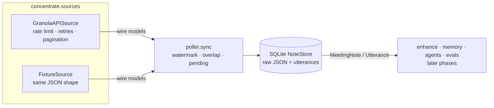

# Concentrate

Concentrate is an open-source research prototype. It compresses Granola meeting notes into a structured, time-aware, source-cited, entity-linked working memory for AI agents. A benchmark tests whether that memory beats "agent + top-k transcript retrieval" on accuracy, tokens and latency.

> **Status: Phase 2 of 7.** The Granola source layer and sync are built, along with the synthetic benchmark (40 meetings, 230 validated questions). There are no results yet.

## Thesis

Granola's CEO has described today's MCP agents as doing "a relatively dumb job", looking at the most relevant meetings. He wants Granola to send agents a compressed, always-ready context instead: "apple juice from concentrate". *(Full quote and sources to be added with the Phase 7 write-up.)*

Concentrate tests that idea with numbers, and reports them whichever way they come out.

## Architecture (Phase 1)



## Quick start

```bash
uv sync
```

```bash
uv run concentrate sync --source fixtures
```

```bash
uv run pytest
```

To regenerate the benchmark dataset (deterministic, free), run:

```bash
uv run concentrate synth --seed 42
```

To preview the cost of the optional LLM-polished version, run:

```bash
uv run concentrate synth --seed 42 --estimate
```

To sync from your real Granola account (Business/Enterprise plan; the key never leaves your machine or logs), copy `.env.example` to `.env`, set `GRANOLA_API_KEY=grn_…`, then run:

```bash
uv run concentrate sync --source granola
```

To open the note-view prototype (Next.js; reads `data/fixtures/northwind`), run:

```bash
cd web && npm install && npm run dev
```

Then open http://localhost:3100. It shows Granola-style notes with an enhanced transcript: hover a green mention to see who or what it links to and why. The linker is a labelled stand-in until Phase 4.

## The benchmark: Northwind Labs (synthetic)

`data/fixtures/northwind/` holds a fictional 25-person startup recorded over 8 weeks: 40 Granola-shaped notes (standups, 1:1s, customer calls, design reviews, all-hands, an investor update; remote and in-person). Alongside them sit `world.json` (the ground-truth timeline) and `questions.jsonl` (230 questions with gold answers and gold utterance IDs). The ground truth is generated first and the meetings are rendered from it, so every answer is verifiable. The traps are deliberate:
- two Sams and two Alexes;
- the internal project Beacon vs the customer Beacon Freight;
- one project with three names: Falcon = the payments migration = PAY-212;
- a price that changes, a launch that slips twice, and a handoff;
- commitments that are kept, slipped, dropped or reassigned;
- Me/Them-only transcripts with ASR noise;
- private content for redaction tests.

See [`docs/DESIGN.md`](docs/DESIGN.md#phase-2-synthetic-company-and-benchmark-questions).

## Docs

- [`docs/SCHEMA_NOTES.md`](docs/SCHEMA_NOTES.md): every Granola field we rely on, tagged VERIFIED / ASSUMED / CORRECTED.
- [`docs/DESIGN.md`](docs/DESIGN.md): decisions and trade-offs.
- [`docs/UI_REFERENCES.md`](docs/UI_REFERENCES.md): Mobbin references for the Phase 6 web UI.

## Roadmap

1. ✅ Models, Source layer, sync
2. ✅ Synthetic company "Northwind Labs" + 230 benchmark questions (template rendering; LLM polish pending)
3. Baselines: Granola-MCP-style top-k, summaries-only, full-context oracle
4. Concentrate core: enhanced transcripts, grounded fact extraction, bitemporal memory, compression tiers
5. Profiles, share-safe redaction, pre-meeting briefs
6. CLI, MCP server, API + web UI
7. Evaluation and write-up
