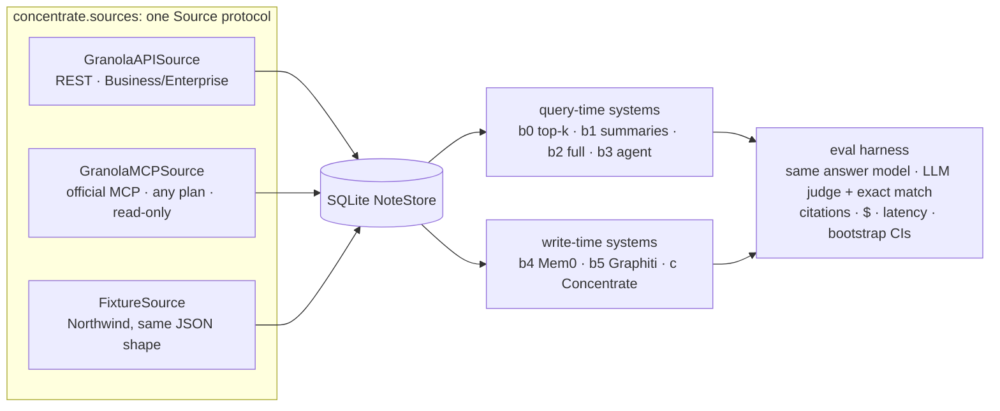

# Concentrate

**An open benchmark for agent memory over meeting notes, and a comparison of the ways to build that memory.** It's modelled on Granola's note and transcript format and calibrated on real Granola data.

When an AI agent needs to know "what did we decide about pricing, and who owns the follow-up?", it can:
- search transcripts at question time (what Granola's MCP agent does today);
- read summaries;
- read everything;
- query a memory built ahead of time: Mem0, Graphiti, or **Concentrate**, the precomputed meeting memory built here.

This project measures all of those on the same questions for **accuracy, cost and latency**, and reports where each one breaks.

> **Status (2026-11-02): XL results pending.**
> - The benchmark, all seven systems and the eval harness are built and tested.
> - Memory builds for Mem0, Graphiti and Concentrate on the 184-meeting set are running.
> - A pilot on the small set saturated (90–100%), which is why the large set exists.
>
> Numbers go here once the final run on the held-out test split is done, good or bad.

## What's here

1. **[The benchmark](docs/BENCHMARK.md): Northwind meeting memory.** Existing memory benchmarks (LongMemEval, LoCoMo, BEAM, RealMem) are chat logs; we found none built on meetings. Northwind is a synthetic company with 184 meetings and 296 questions, each with a verified answer and the gold transcript lines. It covers:
   - who said what when the speaker isn't labelled;
   - which of three Sams someone means;
   - what a price was *as of* a given week;
   - whether a commitment was kept, slipped, reassigned or dropped.
2. **[Findings from Granola's live MCP](docs/PROBE_2026-11-02.md).** A read-only probe on real meetings, summarised below.
3. **Seven systems under one harness:**
   - query-time: top-k retrieval, summaries only, a full-context ceiling, and an agent modelled on Granola's MCP;
   - write-time: Mem0, Graphiti and Concentrate.
4. **Concentrate,** one strong entry in that comparison. Its pipeline:
   - resolve speakers and entities;
   - extract atomic facts that cite their transcript lines;
   - drop any fact its cited lines don't support;
   - store facts with the dates they were true.

   It's included to show what a meeting-specific memory *can* achieve, not as a claim that the techniques are new. Graphiti, Mem0 and others already do time-aware facts; the meeting-specific parts are what's being tested.
5. **The retirement question** (planned): Granola has said it's weighing deleting old transcripts while keeping a working memory. We'll delete transcripts older than N days, re-run the benchmark, and report what's lost.

## What the live probe found

Granola's MCP is now an agent: `query_granola_meetings` searches and reads notes and returns cited answers, and there's chunked transcript search. So the baseline to beat is **per-query agentic retrieval**, not naive top-k. The read-only probe on 2026-11-02 still found:
- **A cross-meeting identity miss.** Asked about a teammate, it found them in one meeting and missed another where the invite showed only their email handle.
- **In-person attribution.** One shared microphone means commitments came back owned by "Unidentified speaker".
- **Summary-first answers.** Exact details cost extra transcript round-trips on every question.

These are observations from a handful of real meetings, reported so they can be reproduced, not a measured error rate.

## How a run works



Every system uses the same answer model (Opus 5.5) and the same judge. Differences come from what each system puts in front of the model.

## Quick start

Install:

```bash
uv sync
```

Run the tests:

```bash
uv run pytest
```

Generate the large benchmark (deterministic, free):

```bash
uv run concentrate synth --seed 42 --scale xl
```

Price an eval before running it (free):

```bash
uv run concentrate eval --xl --split dev --estimate
```

Anything over $2 asks for confirmation before it runs. The full commands, including building Mem0, Graphiti and Concentrate memories, are in [`docs/BENCHMARK.md`](docs/BENCHMARK.md#run-it).

**Your own Granola notes** sync through the official MCP on any plan. It opens your browser once to sign in, tokens stay in `~/.config/concentrate/`, and it never calls write tools.

```bash
uv run concentrate sync --source granola-mcp
```

With a Business/Enterprise API key (`GRANOLA_API_KEY=grn_…` in `.env`), the REST API works too:

```bash
uv run concentrate sync --source granola
```

A Granola-style note viewer shows enhanced transcripts with linked mentions (Next.js, port 3100):

```bash
cd web && npm install && npm run dev
```

The same app has a **results explorer** at `/results`: leaderboard, cost-vs-accuracy, a category heatmap, and a drill-down from any question to every system's answer and the transcript lines it cited (see [docs/RESULTS_EXPLORER.md](docs/RESULTS_EXPLORER.md)).

## Honest limits

- **The benchmark is synthetic.** That's its biggest weakness. Real meetings are messier, and calibration used a handful of real meetings, not thousands.
- **b3 re-implements the shape of Granola's agent; it isn't Granola's agent.** The real one only reads the connected user's account, so it can't run on synthetic data.
- **Granola has far more data and signal** (audio, millions of meetings) than this project. The aim is an independent, reproducible measurement, not a better product.

## Docs

- [`docs/BENCHMARK.md`](docs/BENCHMARK.md): benchmark card covering construction, categories, metrics, systems, how to run and add one, and limitations.
- [`docs/PROBE_2026-11-02.md`](docs/PROBE_2026-11-02.md): live probe of Granola's MCP.
- [`docs/PHASE4_DESIGN.md`](docs/PHASE4_DESIGN.md): Concentrate's design.
- [`docs/concentrate/`](docs/concentrate/): Concentrate's memory and enhance stages.
- [`docs/baselines/`](docs/baselines/): how the Mem0 and Graphiti baselines are wired.
- [`docs/SCHEMA_NOTES.md`](docs/SCHEMA_NOTES.md): every Granola field relied on, tagged VERIFIED / ASSUMED.
- [`docs/DESIGN.md`](docs/DESIGN.md): decisions and trade-offs, including bad results.

## Roadmap

1. ✅ Source layer (REST API, MCP, fixtures) and sync
2. ✅ Northwind benchmark, base and XL, calibrated on real transcripts
3. ✅ Query-time baselines (b0–b3) and the eval harness; pilot on base (saturated)
4. ✅ Write-time systems: Mem0, Graphiti and Concentrate built; 🛠 XL memory builds running
5. 🛠 **Final comparison** on the XL test split: accuracy by category, cost, latency
6. Transcript-retirement curve, ablations, failure analysis, write-up
7. Later: hybrid-room meetings, an LLM-polished benchmark variant, a public leaderboard
