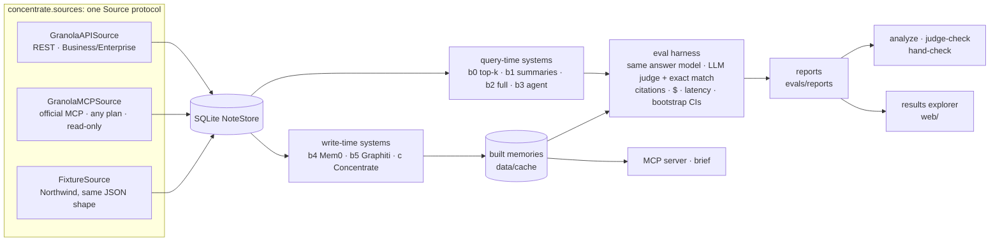

# Hindsight: an open benchmark for agent memory over meeting notes

**When an agent asks "what did we decide about pricing, and who owns the follow-up?", should it search transcripts on the spot or read a memory built ahead of time?**
Hindsight measures seven ways of answering on the same 296 questions about 184 synthetic meetings, for accuracy, cost and latency, and reports where each one breaks.
One of the seven is **Concentrate**, a cited, time-aware meeting memory built here; the benchmark, harness and data are open so you can add your own.

> **Not affiliated with Granola.** This is an independent research prototype. It reads and writes data in the formats of Granola's public REST API and official MCP server, and was calibrated on the author's own Granola meetings. The web UI is inspired by Granola's visual language but uses none of its name, logo or fonts.

## Results

<!-- RESULTS:START -->
## Results (first comparison, 2026-11-02)

The comparison used **120 held-out test questions** from Northwind-XL v1 (184 meetings). Every system has the same answer model (Opus 5.5) and the same judge. Report: [`evals/reports/20261103T002456Z.md`](evals/reports/20261103T002456Z.md). Significance and failure analysis: [`.analysis.md`](evals/reports/20261103T002456Z.analysis.md).

| System | Accuracy [95% CI] | $ / question | p50 latency | One-off ingest |
|---|---|---|---|---|
| Oracle (reads only the gold meetings; a ceiling) | 95% [91, 98] | 0.046 | 4.5 s | — |
| **Concentrate** (precomputed memory) | **92% [86, 96]** | **0.022** | 3.8 s ¹ | $5 |
| Agent over search + transcripts (modelled on Granola's MCP) | 90% [84, 95] | 0.137 | 13.2 s | — |
| Top-k hybrid retrieval (k = 10 meetings) | 88% [82, 94] | 0.177 | 6.4 s ¹ | — |
| Mem0 | 81% [73, 88] | 0.017 | 3.3 s | $17 |
| Graphiti | 72% [63, 79] | 0.029 | 4.1 s | $70 ² |
| Summaries only | 71% [62, 78] | 0.009 | 4.7 s ¹ | — |

**What the numbers support:**
- **Concentrate, the agent and top-k are statistically tied.** Paired McNemar tests with Holm correction show no reliable difference; Concentrate and the agent disagreed on only 10 questions, splitting 6–4.
- **Concentrate costs about a sixth as much per question as the agent.** Including ingest, the agent and top-k are dominated on cost vs accuracy.
- **Concentrate beats Mem0 (+11 points), Graphiti (+20) and summaries (+21)**, and all three gaps are reliable.
- **On the dev split, deleting every transcript older than the question barely moves Concentrate (89% → 88%), while summaries alone score 64%.** See [`docs/RETIREMENT.md`](docs/RETIREMENT.md). This benchmark version has no exact-quote questions, though, so it can't show what deletion loses. [`docs/BENCHMARK_V2_EXTRAS.md`](docs/BENCHMARK_V2_EXTRAS.md) adds them.

**Reasons to be skeptical. Read these before quoting the table:**
- **Concentrate has a home advantage.** The same author designed the question generator and Concentrate's extractor, and the facts it extracts match the question categories.
- **Only Concentrate gets an org directory** (names, roles, emails), which it uses to resolve people. The other systems don't. Removing it (the directory ablation) hasn't been run yet.
- **The effort was unequal.** Concentrate was tuned on the dev split. Mem0, Graphiti and the agent use our default wiring and untuned prompts. Graphiti's low score probably says more about our setup than about Graphiti.
- **The benchmark saturates near the top.** Synthetic v1 wording is templated (see [`docs/FIDELITY.md`](docs/FIDELITY.md)). A harder v2 corpus exists ([`docs/FIDELITY_V2.md`](docs/FIDELITY_V2.md)), but nothing has been run on it yet.
- **The agent is our re-implementation, not Granola's agent.** A comparison against Granola's real agent on real meetings is in progress ([`docs/REAL_SLICE.md`](docs/REAL_SLICE.md)).

¹ Batched systems' latency comes from the 10 questions run interactively, not all 120. ² Includes $10.66 of work lost to a crashed embedded database and redone ([`docs/HARDENING.md`](docs/HARDENING.md)).
<!-- RESULTS:END -->

## Why "Concentrate"?

In July 2026, Granola's CEO described agents reading the most relevant meetings at query time, and said Granola should instead hand agents a compressed, always-ready context: ["apple juice from concentrate"](https://www.platformer.news/granola-chris-pedregal-interview/). That line named the memory system and posed the question this repo tests: does precomputed memory beat per-query retrieval, and at what cost?

## What's inside

| | What | Where |
|---|---|---|
| **Benchmark** | *Northwind*: a synthetic company with 184 meetings and 296 questions (90 dev / 206 test), each with a verified answer and the gold transcript lines. The world is generated first, so every answer is known by construction. Nine categories, including who said what when the speaker isn't labelled, which of three Sams someone means, a price *as of* a given week, and whether a commitment was kept, slipped, reassigned or dropped. Existing memory benchmarks (LongMemEval, LoCoMo, BEAM, RealMem) are chat logs; we found none built on meetings. | [`docs/BENCHMARK.md`](docs/BENCHMARK.md) |
| **7 systems** | *Query-time:* b0 top-k retrieval, b1 summaries only, b2/b2o full-context ceiling, b3 an agent shaped like Granola's MCP. *Write-time:* b4 Mem0, b5 Graphiti, c Concentrate. | [`docs/baselines/`](docs/baselines/), [`docs/concentrate/`](docs/concentrate/) |
| **Harness** | Same answer model (Opus 5.5) and judge for every system. Accuracy with bootstrap CIs, exact match, abstention, citation precision/recall against gold lines, $/question, latency, one-off ingest cost. A second judge and a blind hand check audit the primary judge; `analyze` adds paired significance, a Pareto frontier and a failure taxonomy. | [`docs/BENCHMARK.md`](docs/BENCHMARK.md#metrics), [`docs/ANALYSIS.md`](docs/ANALYSIS.md) |
| **Live probe** | A read-only probe of Granola's real MCP on real meetings (below). | [`docs/PROBE_2026-11-02.md`](docs/PROBE_2026-11-02.md) |
| **MCP server** | Serve a built Concentrate memory to Claude Desktop or Claude Code next to Granola's MCP, and ask both the same question. Six read-only tools: facts with validity dates, commitments and their outcomes, entity resolution, cited transcript lines. | [`docs/MCP_SERVER.md`](docs/MCP_SERVER.md) |
| **Explorer** | A Next.js app: a Granola-style note viewer with linked mentions, and a results explorer (leaderboard, cost vs accuracy, category heatmap, drill-down from any question to every system's answer and cited lines). | [`docs/RESULTS_EXPLORER.md`](docs/RESULTS_EXPLORER.md) |
| **Brief** | A pre-meeting brief built from memory: open commitments, what changed since this group last met, open customer requests. Evaluated against ground truth. | [`docs/BRIEF.md`](docs/BRIEF.md) |

**Concentrate** resolves speakers and entities, extracts atomic facts that cite their transcript lines, drops any fact its cited lines don't support, and stores facts with the dates they were true. It's here to show what a meeting-specific memory *can* achieve, not as a claim that the techniques are new: Graphiti, Mem0 and others already do time-aware facts. The meeting-specific parts are what's being tested ([`docs/PHASE4_DESIGN.md`](docs/PHASE4_DESIGN.md)).

## What the live probe found

Granola's MCP is now an agent: `query_granola_meetings` searches and reads notes and returns cited answers, and there's chunked transcript search. So the baseline to beat is **per-query agentic retrieval**, not naive top-k. The read-only probe on 2026-11-02 still found:
- **A cross-meeting identity miss.** Asked about a teammate, it found them in one meeting and missed another where the invite showed only their email handle.
- **In-person attribution.** One shared microphone means commitments came back owned by "Unidentified speaker".
- **Summary-first answers.** Exact details cost extra transcript round-trips on every question.

These are observations from a handful of real meetings, reported so they can be reproduced, not a measured error rate.

## Quick start

Needs Python 3.11 and [uv](https://docs.astral.sh/uv/). Everything in this first block is free: no API key, no LLM calls.

```bash
uv sync                                                # install (locked)
uv run pytest                                          # ~270 tests, no network
uv run concentrate synth --seed 42 --scale xl          # generate the 184-meeting benchmark (~5 s, deterministic)
uv run concentrate eval --xl --split dev --estimate    # price an eval run without running it
uv run concentrate fidelity data/fixtures/northwind    # style statistics of a corpus
```

The first `eval` downloads a small embedding model from Hugging Face. The 40-meeting base set is committed at `data/fixtures/northwind`; the XL set is regenerated into `data/fixtures/large/` (git-ignored).

**Running systems costs API credit.** Copy `.env.example` to `.env` and set `ANTHROPIC_API_KEY`. Every command prints an estimate first and asks before spending more than $2. LLM calls are disk-cached, so reruns are free.

```bash
uv run concentrate eval --split dev --systems b1 --limit 10      # small pilot on the base set (~$0.60)
uv run concentrate ingest --help                                 # build Mem0 / Graphiti / Concentrate memories (resumable)
uv run concentrate mcp-serve --xl                                # serve a built XL memory over MCP (stdio)
```

**The web app** (note viewer and results explorer, port 3100; reads `evals/reports/` directly):

```bash
cd web && npm install && npm run dev    # then open http://localhost:3100/results
```

**Your own Granola notes** sync through the official MCP on any plan. It opens your browser once to sign in, keeps tokens in `~/.config/concentrate/`, and never calls write tools. With a Business/Enterprise API key (`GRANOLA_API_KEY` in `.env`) the REST API works too. Synced notes go to a local SQLite file and are never committed.

```bash
uv run concentrate sync --source granola-mcp   # or: --source granola
```

## How a run works



Every system uses the same answer model and the same judge, so differences come from what each system puts in front of the model. All Granola I/O lives behind the `Source` protocol, and fixtures use the exact API response shape, validated by the same Pydantic models as real data.

## Honest limits

- **The benchmark is synthetic.** That's its biggest weakness. Real meetings are messier, and calibration used a handful of real meetings, not thousands. In v1 (Northwind-XL), 78% of longer transcript passages were exact copies of 69 filler sentences, which made retrieval unrealistically easy. v2 (generator `northwind-2`) cuts that to 4.9%, but its sentence frames still repeat: 54% of long passages share their first six words with another, against 0.6% in real meetings ([FIDELITY_V2](docs/FIDELITY_V2.md)).
- **b3 re-implements the shape of Granola's agent; it isn't Granola's agent.** The real one only reads the connected user's account, so it can't run on synthetic data.
- **One answer model, one primary judge.** The judge is also the answer model; a second judge and a hand check measure that bias rather than remove it.
- **Granola has far more data and signal** (audio, millions of meetings) than this project. The aim is an independent, reproducible measurement, not a better product.

## Docs

| Doc | What it covers |
|---|---|
| [`docs/BENCHMARK.md`](docs/BENCHMARK.md) | Benchmark card: construction, categories, metrics, systems, limitations |
| [`data/README.md`](data/README.md) | Dataset card for Northwind (Hugging Face format) |
| [`docs/PROBE_2026-11-02.md`](docs/PROBE_2026-11-02.md) | Live probe of Granola's MCP |
| [`docs/FIDELITY.md`](docs/FIDELITY.md), [`docs/FIDELITY_V2.md`](docs/FIDELITY_V2.md) | How close the synthetic transcripts are to real ones |
| [`docs/PHASE4_DESIGN.md`](docs/PHASE4_DESIGN.md), [`docs/concentrate/`](docs/concentrate/) | Concentrate's design, memory and enhance stages |
| [`docs/baselines/`](docs/baselines/) | How the Mem0 and Graphiti baselines are wired |
| [`docs/ANALYSIS.md`](docs/ANALYSIS.md) | Significance, power, Pareto frontier, failure taxonomy |
| [`docs/MCP_SERVER.md`](docs/MCP_SERVER.md), [`docs/BRIEF.md`](docs/BRIEF.md), [`docs/RESULTS_EXPLORER.md`](docs/RESULTS_EXPLORER.md) | MCP server, pre-meeting brief, results explorer |
| [`docs/SCHEMA_NOTES.md`](docs/SCHEMA_NOTES.md) | Every Granola field relied on, tagged VERIFIED / ASSUMED |
| [`docs/HARDENING.md`](docs/HARDENING.md) | Timeouts, retries, stall watchdog, resumable builds, CI |
| [`docs/DESIGN.md`](docs/DESIGN.md) | Decisions and trade-offs, including bad results |
| [`docs/SCOPE.md`](docs/SCOPE.md), [`docs/UI_REFERENCES.md`](docs/UI_REFERENCES.md) | Project map; UI references |
| [`CONTRIBUTING.md`](CONTRIBUTING.md), [`SECURITY.md`](SECURITY.md) | Adding a system, running the benchmark; reporting a problem |
<!-- Coordinator: add rows for docs merged from other workstreams (e.g. RETIREMENT.md, writeup/, guide/). -->

## Roadmap

1. ✅ Source layer (REST API, MCP, fixtures) and sync
2. ✅ Northwind benchmark, base and XL, calibrated on real transcripts; v2 wording
3. ✅ Query-time baselines (b0–b3) and the eval harness; pilot on base (saturated)
4. ✅ Write-time systems: Mem0, Graphiti and Concentrate
5. 🛠 **Final comparison** on the XL test split: accuracy by category, cost, latency
6. Transcript-retirement curve, ablations, failure analysis, write-up
7. Later: hybrid-room meetings, an LLM-polished benchmark variant, a public leaderboard

## Citation

```bibtex
@software{lakhani2026hindsight,
  author = {Lakhani, Kian},
  title  = {Hindsight: an open benchmark for agent memory over meeting notes},
  year   = {2026},
  note   = {Research prototype; includes the Northwind meeting-memory benchmark and the Concentrate memory system}
}
```

See also [`CITATION.cff`](CITATION.cff). Code is [MIT](LICENSE); the synthetic Northwind data is [CC BY 4.0](data/README.md#license).
