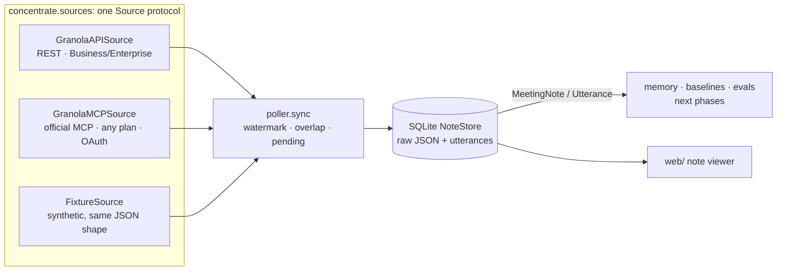

# Concentrate

Concentrate is an open-source research prototype. It turns Granola meeting notes into a **precomputed working memory** for AI agents: atomic facts that are time-aware (what was true *when*), entity-resolved (*which* Sam), and cited down to the transcript line. The project's job is to measure, honestly, whether that memory answers agents' questions better, cheaper or faster than retrieving from notes and transcripts at query time.

> **Status: no results yet.** Built so far:
> - Granola connectors: the official REST API, and the MCP, which works on any plan;
> - a synthetic benchmark (40 meetings, 230 validated questions);
> - a Granola-style note viewer.
>
> The memory engine, the baselines and the evaluation are the next phases.

## Why, and what we learned first

In July 2026, Granola's CEO described agents connected through Granola's MCP as looking at the most relevant meetings, and said Granola should send agents a compressed, always-ready context instead: ["apple juice from concentrate"](https://www.platformer.news/granola-chris-pedregal-interview/). That framing is the origin of this project.

**A live probe on 2026-11-02 showed the MCP has moved on** (see [`docs/PROBE_2026-11-02.md`](docs/PROBE_2026-11-02.md)):
- `query_granola_meetings` is now an *agent* that searches and reads notes, and it returns structured, cited answers (e.g. a commitments table with "later status").
- There's new chunked transcript search (`search_transcripts`), write tools, and detailed guardrails telling agents to verify against transcripts.

So the baseline to beat is **per-query agentic retrieval**, not naive top-k. Where the probe still found gaps:
- **Cross-meeting entity resolution.** Asked who a teammate was, it found them in one meeting and missed an earlier one where they were named but the invite showed only an email handle.
- **Speaker attribution in person.** Everyone shares one microphone, so commitments came back owned by "Unidentified speaker".
- **Summary-first answers.** Exact details need extra transcript round-trips, which costs latency and tokens on every question.

**The question Concentrate answers:** does building the memory once, at ingest, beat retrieval at query time on accuracy (especially *who*, *when* and *status* questions), tokens, and latency? And can old transcripts be deleted while keeping that memory, and what's lost if they are? The project reports the numbers either way.

## Architecture



Everything downstream of `Source` is identical whichever source the notes came from.

## Quick start

```bash
uv sync
```

```bash
uv run pytest
```

Load the synthetic benchmark into the local store:

```bash
uv run concentrate sync --source fixtures
```

Load **your own Granola notes** through the official MCP. This works on any plan (free plans see the last 30 days). It opens your browser once to sign in, the tokens stay in `~/.config/concentrate/` and are never logged, and it's read-only.

```bash
uv run concentrate sync --source granola-mcp
```

With a Business/Enterprise API key (`GRANOLA_API_KEY=grn_…` in `.env`), the REST API works too:

```bash
uv run concentrate sync --source granola
```

Regenerate the benchmark (deterministic, free):

```bash
uv run concentrate synth --seed 42
```

Open the note viewer (Next.js, reads `data/fixtures/northwind`):

```bash
cd web && npm install && npm run dev
```

Then open http://localhost:3100. It shows Granola-style notes; open the transcript and hover a green mention to see who or what it links to and why. The linker there is a labelled stand-in until the memory engine exists.

## The benchmark: Northwind Labs (synthetic)

`data/fixtures/northwind/` holds a fictional 25-person startup over 8 weeks: 40 notes in Granola's exact API shape (standups, 1:1s, customer calls, design reviews, all-hands, an investor update; remote and in-person). The ground truth (`world.json`) is generated first and the meetings are rendered from it, so all 230 questions in `questions.jsonl` have verified answers and gold transcript lines.

The traps are deliberate:
- two Sams and two Alexes;
- the project Beacon vs the customer Beacon Freight;
- Falcon = the payments migration = PAY-212;
- a price that changes, a launch that slips twice, and a handoff;
- commitments that are kept, slipped, dropped or reassigned;
- private content for redaction tests.

Transcripts follow the format seen live: short fragmentary passages, the owner on the microphone, other speakers on system audio and only *partly* identified by name, attendees sometimes known only by email, and ASR noise such as misheard names.

**Limits:** it's synthetic and small (~20k words). Meeting wording is template-generated; an LLM-polished version is built and validated but not yet run. Real-data checks come from the MCP source, on the author's 4 meetings so far.

## Docs

- [`docs/PROBE_2026-11-02.md`](docs/PROBE_2026-11-02.md): live probe of Granola's MCP and what it changes.
- [`docs/SCHEMA_NOTES.md`](docs/SCHEMA_NOTES.md): every Granola field we rely on, tagged VERIFIED / ASSUMED / CORRECTED, plus the MCP mapping.
- [`docs/DESIGN.md`](docs/DESIGN.md): decisions and trade-offs.
- [`docs/UI_REFERENCES.md`](docs/UI_REFERENCES.md): Mobbin references for the web UI.

## Roadmap

1. ✅ Models, Source layer (API, MCP, fixtures), sync
2. ✅ Synthetic benchmark, matched to the live transcript format (LLM polish built, not yet run)
3. **Baselines:** an agentic retriever mirroring today's MCP (search → summaries → transcript chunks), plain top-k, summaries-only, and a full-context ceiling
4. **Concentrate core:** entity linking, grounded fact extraction, time-aware memory, compression tiers
5. **Evaluation:** accuracy by question type, tokens, latency, and what's lost when transcripts are retired; failure analysis
6. Later, if the results justify it: profiles, share-safe redaction, pre-meeting briefs, an MCP server, and the full UI
