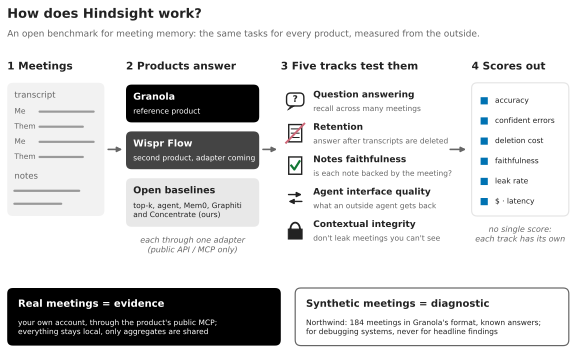
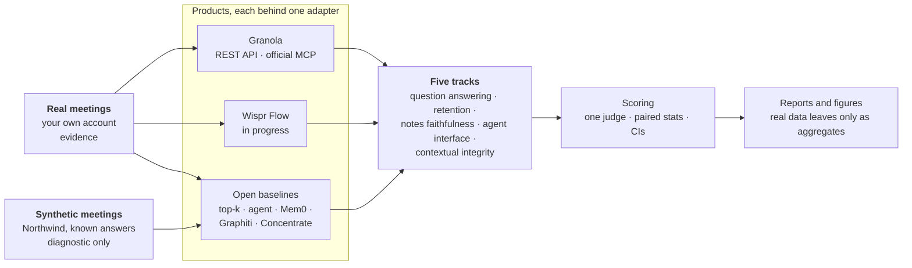
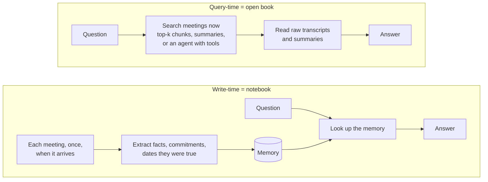
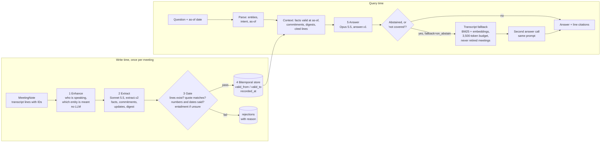
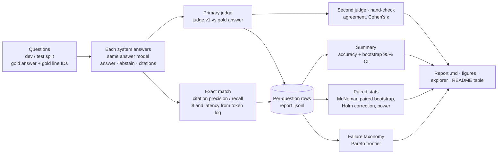
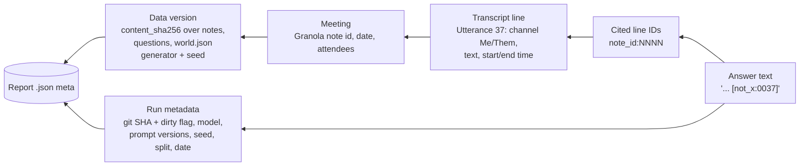

# Architecture

Five diagrams, each with a short caption and links to the code it describes. They are in Mermaid, so GitHub renders them. The picture above is the ten-second version ([`figures/overview.svg`](../figures/overview.svg)); [`figures/tracks.svg`](../figures/tracks.svg) shows each track's task, metrics and status.

The diagrams show what is **built**, except where a box says *planned* or *in progress*. Every arrow that touches a product goes through a public interface (an API or an MCP); nothing here depends on product internals.

1. [System map](#1-system-map)
2. [Query-time vs write-time](#2-query-time-vs-write-time-the-core-idea)
3. [The Concentrate pipeline](#3-the-concentrate-pipeline)
4. [The evaluation pipeline](#4-the-evaluation-pipeline)
5. [The provenance chain](#5-the-provenance-chain)

---

## 1. System map

**Two roles for data.** Headline findings come only from real meetings, read through the product's public interface on the owner's own account; only aggregates are committed. Synthetic meetings (Northwind) have known answers, so they are for debugging and comparing open systems, never for headlines: they agreed with real meetings on some systems and badly misled us on others ([`figures/synthetic_vs_real.svg`](../figures/synthetic_vs_real.svg)). Products that can't load our corpus, such as Granola, appear only on the real side.

**Inside the adapters.** Meetings come in through one door, the `Source` protocol, whether they are synthetic (Northwind fixtures), from Granola's REST API, or from Granola's official MCP; everything downstream reads the same `NoteStore` and never knows which source it came from. The open baselines answer from that store with one answer model; the harness scores every system with one judge, and every run writes a report that the analysis, the figures and the web explorer all read. Granola's own agent is the exception: it can only read the connected user's account, so it is queried as a black box through its MCP, on real meetings only.

Code: [`sources/base.py`](../../packages/concentrate/sources/base.py) (the `Source` protocol) · [`granola_api.py`](../../packages/concentrate/sources/granola_api.py) · [`granola_mcp.py`](../../packages/concentrate/sources/granola_mcp.py) · [`fixtures.py`](../../packages/concentrate/sources/fixtures.py) · [`core/store.py`](../../packages/concentrate/core/store.py) · [`agents/baselines.py`](../../packages/concentrate/agents/baselines.py) (b0–b3) · [`mem0_system.py`](../../packages/concentrate/agents/mem0_system.py) · [`graphiti_system.py`](../../packages/concentrate/agents/graphiti_system.py) · [`concentrate_system.py`](../../packages/concentrate/agents/concentrate_system.py) · [`evals/runner.py`](../../packages/concentrate/evals/runner.py) · [`evals/analyze.py`](../../packages/concentrate/evals/analyze.py) · [`mcp_server/`](../../packages/concentrate/mcp_server/) · [`web/`](../../web/) · field provenance: [`SCHEMA_NOTES.md`](SCHEMA_NOTES.md).

---

## 2. Query-time vs write-time: the core idea

**In plain English.** A query-time system is an open-book exam: it does all its work when the question arrives, searching and reading transcripts every time. A write-time system takes notes as each meeting arrives and later answers from its notebook. The notebook is cheaper and faster per question and can track how things changed, but it only holds what the note-taker chose to write down. That trade-off is the main thing Hindsight measures: on synthetic questions the two tied; on the author's real meetings the notebook missed the long-tail details that real questions ask about ([`results/REAL_SLICE.md`](../results/REAL_SLICE.md)).

Code: query-time b0–b3 in [`agents/baselines.py`](../../packages/concentrate/agents/baselines.py) and [`retrieval.py`](../../packages/concentrate/agents/retrieval.py); write-time systems implement `WriteTimeSystem` in the same file. Systems overview: [`systems/`](../archive/concentrate/).

---

## 3. The Concentrate pipeline

**In plain English.** Each meeting is processed once, oldest first. *Enhance* works out who is speaking and which "Sam" is meant, without an LLM. *Extract* asks a model for atomic facts, each citing the transcript lines it came from. The *Gate* throws out any fact whose cited lines don't actually say it (checked by code first, then by a cheap model only when unsure). Surviving facts go into a store that keeps two clocks, when a fact was true and when we learned it, so "what was the price as of week 3?" has an answer. At question time Concentrate answers from that store; the optional *transcript fallback* (off by default) reads raw transcript passages when the memory says it doesn't know. The fallback result is a **dev** result only ([`systems/concentrate/fallback.md`](../archive/concentrate/fallback.md)).

Code: [`enhance/`](../../packages/concentrate/enhance/) · [`memory/extract.py`](../../packages/concentrate/memory/extract.py) + [`schema.py`](../../packages/concentrate/memory/schema.py) · [`memory/verify.py`](../../packages/concentrate/memory/verify.py) (the gate and `gate_eval`) · [`memory/store.py`](../../packages/concentrate/memory/store.py) (bitemporal store) · [`memory/pipeline.py`](../../packages/concentrate/memory/pipeline.py) (`MemoryBuilder.ingest`) · [`memory/query.py`](../../packages/concentrate/memory/query.py) · [`memory/fallback.py`](../../packages/concentrate/memory/fallback.py) · prompts in [`prompts/`](../../prompts/). Design: [`systems/concentrate/memory.md`](../archive/concentrate/memory.md), [`enhance.md`](../archive/concentrate/enhance.md).

---

## 4. The evaluation pipeline

**In plain English.** Every number in the README comes from this pipe. Each question has a known answer (planted by the generator on synthetic data, approved by the meeting owner on real data). Every system answers with the same model; a judge model grades each answer against the known answer, and a second judge and a hand check measure how much to trust that grading. Because all systems answer the *same* questions, comparisons are paired: we count questions where one system was right and the other wrong, and correct for testing many pairs at once, so a tie is never reported as a win. Metric definitions live in [`benchmark/METRICS.md`](../method/METRICS.md).

Code: [`evals/runner.py`](../../packages/concentrate/evals/runner.py) (`run_eval`, budget guard, report writing) · [`evals/scoring.py`](../../packages/concentrate/evals/scoring.py) (judge, exact match, citations, bootstrap) · [`evals/judge_check.py`](../../packages/concentrate/evals/judge_check.py) · [`evals/stats.py`](../../packages/concentrate/evals/stats.py) · [`evals/analyze.py`](../../packages/concentrate/evals/analyze.py) · [`evals/failures.py`](../../packages/concentrate/evals/failures.py) · [`evals/pareto.py`](../../packages/concentrate/evals/pareto.py) · [`evals/real_slice.py`](../../packages/concentrate/evals/real_slice.py) (real-meeting track). Analysis write-up: [`results/ANALYSIS.md`](../archive/northwind/ANALYSIS.md).

---

## 5. The provenance chain

**In plain English.** Any answer can be traced back to the words that support it. Systems cite line IDs like `not_x:0037`, meaning line 37 of note `not_x`; the line ID is built the same way for synthetic and real notes, so a citation leads to one transcript line, which belongs to one meeting. Separately, each report records the git commit, model, prompt versions and seed, plus a hash of the exact data it ran on, so a reader can check they are re-running the same thing. Note the limits: a citation proves where an answer *claims* to come from; whether the line really supports it is what the judge and citation scores check.

Code: [`core/models.py`](../../packages/concentrate/core/models.py) (`utterance_id`, `channel_of`) · [`memory/extract.py`](../../packages/concentrate/memory/extract.py) (`local_line`, `to_full_ids`) · [`memory/fallback.py`](../../packages/concentrate/memory/fallback.py) (`cited_line_ids`) · [`evals/scoring.py`](../../packages/concentrate/evals/scoring.py) (`citation_scores`) · [`evals/runner.py`](../../packages/concentrate/evals/runner.py) (`_git`, `fixtures_version`, report `meta`). Channel rules: [`engineering/SCHEMA_NOTES.md`](SCHEMA_NOTES.md).
