# Figures

Generated by `uv run concentrate figures 20261103T002456Z`; do not edit by hand. CI regenerates them from the committed inputs below and fails if they differ.

**How "differ" is checked.** Each figure has a sidecar `data/<name>.values.json` holding every plotted number and string in data coordinates; it must match exactly. The SVG itself is compared structurally (element counts and its words), because text metrics and the last digits of coordinates vary between platforms. On one platform, the same inputs give byte-identical SVGs.

Prices for every dollar figure: $4/M input and $20/M output tokens, applied to every system and every token (equal prices, no discounts).

**One visual language.** Every figure is titled with the question it answers and carries its scope and caveats. One colour per system or condition everywhere (`figstyle.py`); Granola's agent is always black; where real and synthetic share a chart, filled marks are real meetings and hollow marks synthetic.

## Start here

| | |
|---|---|
| [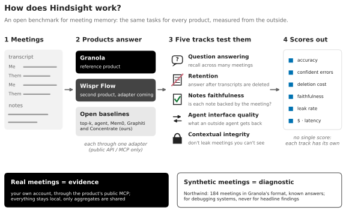](overview.svg) **How does TENOR work?** Belongs in [`engineering/ARCHITECTURE.md`](../engineering/ARCHITECTURE.md) | [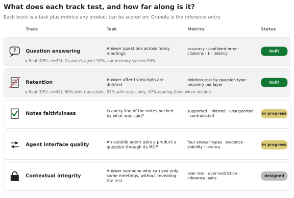](tracks.svg) **What does each track test, and how far along is it?** Belongs in [`tracks/README.md`](../tracks/README.md) |
| [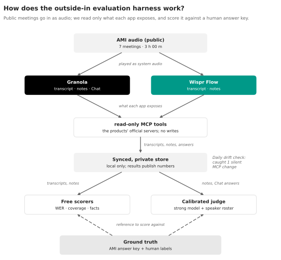](harness_flow.svg) **How does the outside-in evaluation harness work?** Belongs in [`method/CALIBRATED_JUDGING.md`](../method/CALIBRATED_JUDGING.md) |  |

## Real meetings: the evidence

| | |
|---|---|
| [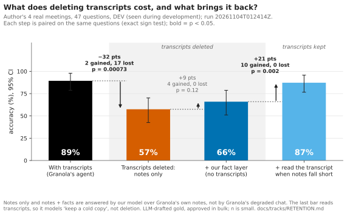](retention_steps.svg) **What does deleting transcripts cost, and what brings it back?** Belongs in [`tracks/RETENTION.md`](../tracks/RETENTION.md) | [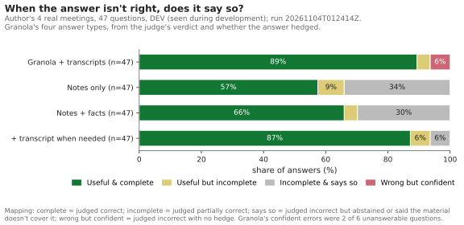](answer_types.svg) **When the answer isn't right, does it say so?** Belongs in [`tracks/RETENTION.md`](../tracks/RETENTION.md) |
| [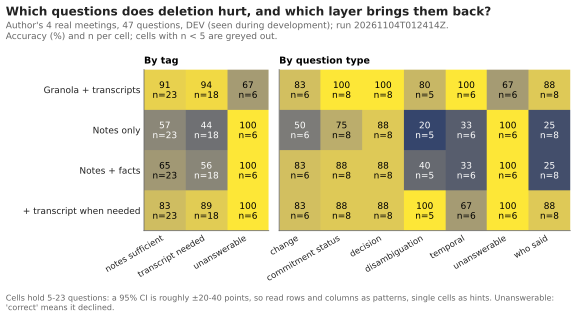](question_heatmap.svg) **Which questions does deletion hurt, and which layer brings them back?** Belongs in [`tracks/RETENTION.md`](../tracks/RETENTION.md) | [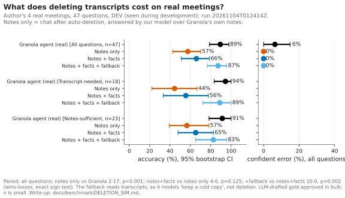](deletion_sim.svg) **What does deleting transcripts cost on real meetings?** Belongs in [`tracks/RETENTION.md`](../tracks/RETENTION.md) |
| [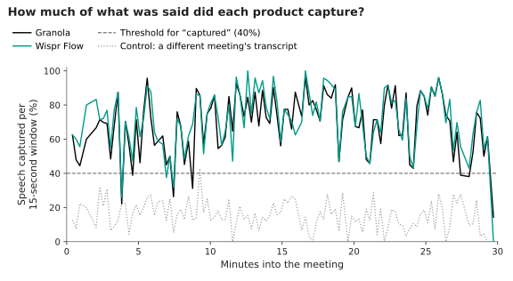](capture_coverage.svg) **How much of what was said did each app catch?** Belongs in [`tracks/CAPTURE.md`](../tracks/CAPTURE.md) | [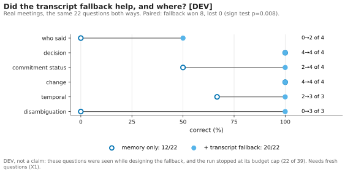](fallback_dev.svg) **Did the transcript fallback help, and where? (DEV)** Belongs in [`archive/concentrate/fallback.md`](../archive/concentrate/fallback.md) |

## Synthetic data: diagnostics, not evidence

| | |
|---|---|
| [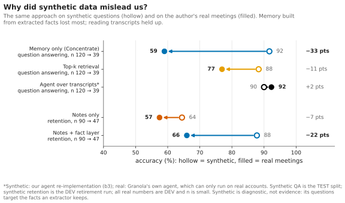](synthetic_vs_real.svg) **Why did synthetic data mislead us?** Belongs in [`results/REAL_SLICE.md`](../results/REAL_SLICE.md) | [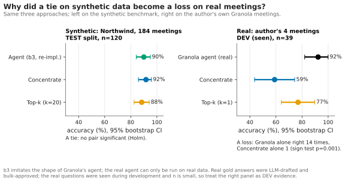](hero_synthetic_vs_real.svg) **Why did a tie on synthetic data become a loss on real meetings?** Belongs in [`results/REAL_SLICE.md`](../results/REAL_SLICE.md) |
| [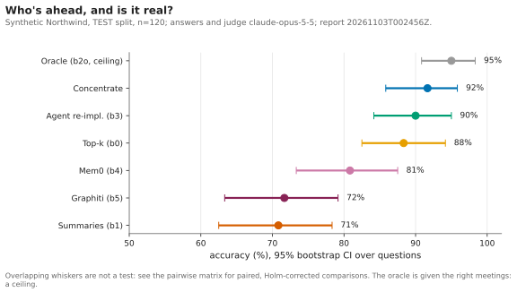](leaderboard.svg) **Who's ahead, and is it real?** Belongs in [`archive/northwind/ANALYSIS.md`](../archive/northwind/ANALYSIS.md) | [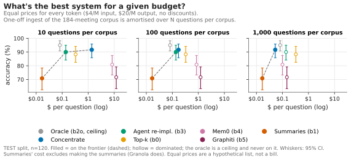](cost_frontier.svg) **What's the best system for a given budget?** Belongs in [`archive/northwind/ECONOMICS.md`](../archive/northwind/ECONOMICS.md) |
| [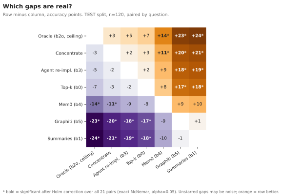](pairwise.svg) **Which gaps are real?** Belongs in [`archive/northwind/ANALYSIS.md`](../archive/northwind/ANALYSIS.md) | [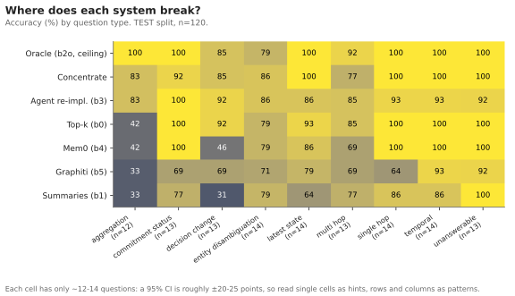](by_category.svg) **Where does each system break?** Belongs in [`archive/northwind/ANALYSIS.md`](../archive/northwind/ANALYSIS.md) |
| [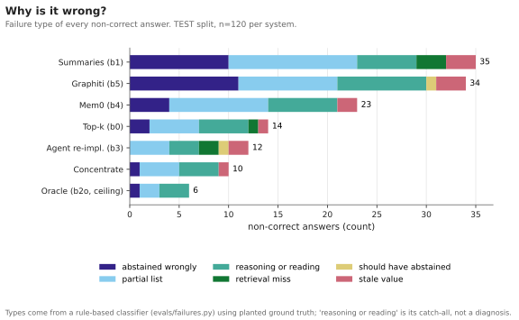](failures.svg) **Why is it wrong?** Belongs in [`archive/northwind/ANALYSIS.md`](../archive/northwind/ANALYSIS.md) | [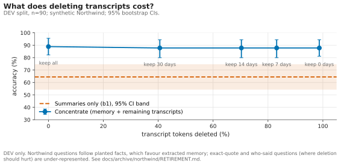](retirement.svg) **What does deleting transcripts cost?** Belongs in [`archive/northwind/RETIREMENT.md`](../archive/northwind/RETIREMENT.md) |
| [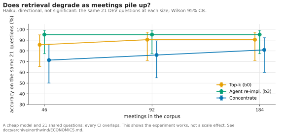](scale.svg) **Does retrieval degrade as meetings pile up?** Belongs in [`archive/northwind/ECONOMICS.md`](../archive/northwind/ECONOMICS.md) | [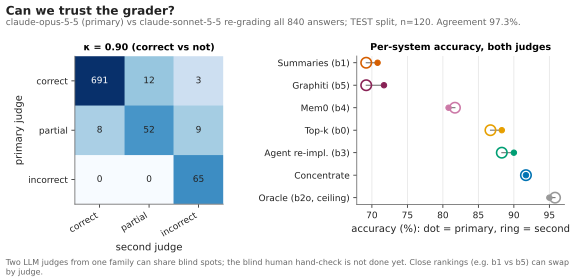](judge_agreement.svg) **Can we trust the grader?** Belongs in [`archive/northwind/ANALYSIS.md`](../archive/northwind/ANALYSIS.md) |
| [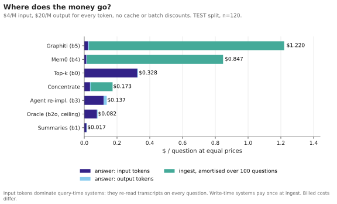](cost_breakdown.svg) **Where does the money go?** Belongs in [`archive/northwind/ECONOMICS.md`](../archive/northwind/ECONOMICS.md) | [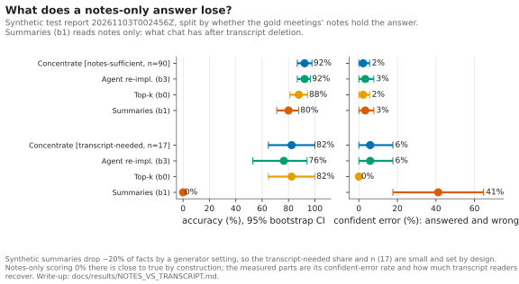](notes_vs_transcript.svg) **What does a notes-only answer lose?** Belongs in [`archive/northwind/NOTES_VS_TRANSCRIPT.md`](../archive/northwind/NOTES_VS_TRANSCRIPT.md) |

## Provenance

| Figure | Question | Inputs (sha256 prefix) |
|---|---|---|
| [overview.svg](overview.svg) | How does TENOR work? | none: a diagram |
| [tracks.svg](tracks.svg) | What does each track test, and how far along is it? | `docs/figures/data/real_slice.json` (1458a32d7155), `evals/reports/real-deletion-sim-dev.aggregate.json` (6bc288f59ce8) |
| [retention_steps.svg](retention_steps.svg) | What does deleting transcripts cost, and what brings it back? | `evals/reports/real-deletion-sim-dev.aggregate.json` (6bc288f59ce8) |
| [answer_types.svg](answer_types.svg) | When the answer isn't right, does it say so? | `evals/reports/real-deletion-sim-dev.aggregate.json` (6bc288f59ce8) |
| [question_heatmap.svg](question_heatmap.svg) | Which questions does deletion hurt, and which layer brings them back? | `evals/reports/real-deletion-sim-dev.aggregate.json` (6bc288f59ce8) |
| [deletion_sim.svg](deletion_sim.svg) | What does deleting transcripts cost on real meetings? | `evals/reports/real-deletion-sim-dev.aggregate.json` (6bc288f59ce8) |
| [harness_flow.svg](harness_flow.svg) | How does the outside-in evaluation harness work? | `evals/reports/ami/coverage.json` (b5c2d4951f7c) |
| [capture_coverage.svg](capture_coverage.svg) | How much of what was said did each app catch? | `evals/reports/ami/coverage.json` (b5c2d4951f7c) |
| [synthetic_vs_real.svg](synthetic_vs_real.svg) | Why did synthetic data mislead us? | `evals/reports/20261103T002456Z.json` (6e5919e818fe), `evals/reports/20261103T002456Z.jsonl` (b8a38cd419b9), `evals/reports/20261103T002456Z.analysis.json` (6098c8d08e82), `docs/figures/data/real_slice.json` (1458a32d7155), `evals/reports/retirement/20261102T224523Z.curve.json` (0e070673f87e), `evals/reports/real-deletion-sim-dev.aggregate.json` (6bc288f59ce8) |
| [hero_synthetic_vs_real.svg](hero_synthetic_vs_real.svg) | Why did a tie on synthetic data become a loss on real meetings? | `evals/reports/20261103T002456Z.json` (6e5919e818fe), `evals/reports/20261103T002456Z.jsonl` (b8a38cd419b9), `evals/reports/20261103T002456Z.analysis.json` (6098c8d08e82), `docs/figures/data/real_slice.json` (1458a32d7155) |
| [leaderboard.svg](leaderboard.svg) | Who's ahead, and is it real? | `evals/reports/20261103T002456Z.json` (6e5919e818fe), `evals/reports/20261103T002456Z.jsonl` (b8a38cd419b9), `evals/reports/20261103T002456Z.analysis.json` (6098c8d08e82) |
| [cost_frontier.svg](cost_frontier.svg) | What's the best system for a given budget? | `evals/reports/20261103T002456Z.json` (6e5919e818fe), `evals/reports/20261103T002456Z.jsonl` (b8a38cd419b9), `evals/reports/20261103T002456Z.analysis.json` (6098c8d08e82) |
| [pairwise.svg](pairwise.svg) | Which gaps are real? | `evals/reports/20261103T002456Z.json` (6e5919e818fe), `evals/reports/20261103T002456Z.jsonl` (b8a38cd419b9), `evals/reports/20261103T002456Z.analysis.json` (6098c8d08e82) |
| [by_category.svg](by_category.svg) | Where does each system break? | `evals/reports/20261103T002456Z.json` (6e5919e818fe), `evals/reports/20261103T002456Z.jsonl` (b8a38cd419b9), `evals/reports/20261103T002456Z.analysis.json` (6098c8d08e82) |
| [failures.svg](failures.svg) | Why is it wrong? | `evals/reports/20261103T002456Z.json` (6e5919e818fe), `evals/reports/20261103T002456Z.jsonl` (b8a38cd419b9), `evals/reports/20261103T002456Z.analysis.json` (6098c8d08e82) |
| [retirement.svg](retirement.svg) | What does deleting transcripts cost? | `evals/reports/retirement/20261102T224523Z.curve.json` (0e070673f87e) |
| [scale.svg](scale.svg) | Does retrieval degrade as meetings pile up? | `evals/scale/20261102T223053Z/scale.json` (02da0cf33e7d) |
| [fallback_dev.svg](fallback_dev.svg) | Did the transcript fallback help, and where? (DEV) | `docs/figures/data/real_slice.json` (1458a32d7155) |
| [judge_agreement.svg](judge_agreement.svg) | Can we trust the grader? | `evals/reports/20261103T002456Z.json` (6e5919e818fe), `evals/reports/20261103T002456Z.jsonl` (b8a38cd419b9), `evals/reports/20261103T002456Z.analysis.json` (6098c8d08e82), `evals/reports/20261103T002456Z.judgecheck.claude-sonnet-5-5.md` (68a03c3a0ddd) |
| [cost_breakdown.svg](cost_breakdown.svg) | Where does the money go? | `evals/reports/20261103T002456Z.json` (6e5919e818fe), `evals/reports/20261103T002456Z.jsonl` (b8a38cd419b9), `evals/reports/20261103T002456Z.analysis.json` (6098c8d08e82) |
| [notes_vs_transcript.svg](notes_vs_transcript.svg) | What does a notes-only answer lose? | `evals/reports/notes_vs_transcript.json` (140841eb96ab) |

`data/real_slice.json` is a content-free snapshot of the real-meeting slice (scores and paired counts only). Rebuild it from the private `data/real/` reports with `uv run concentrate figures 20261103T002456Z --refresh-real`.
