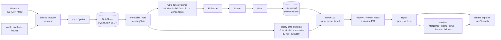
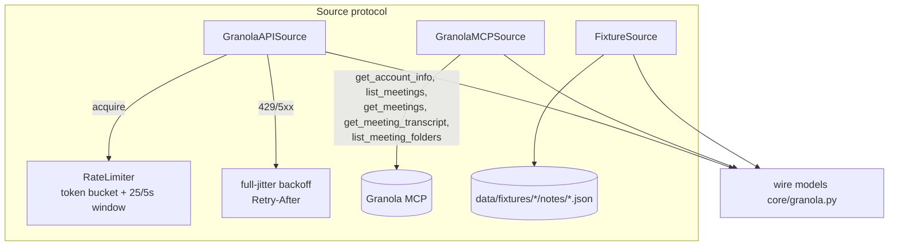
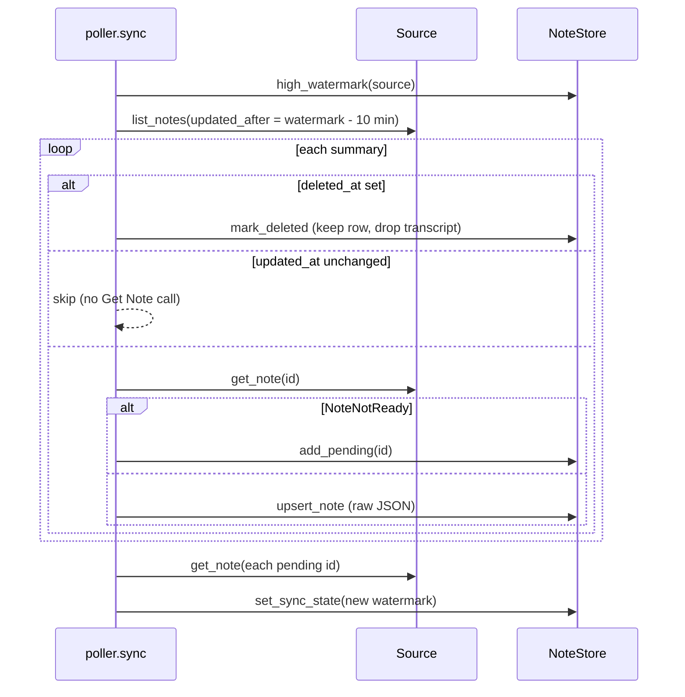
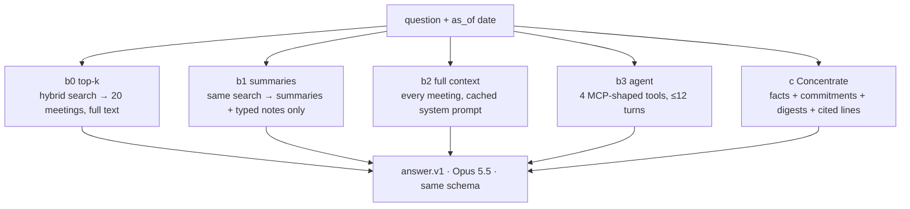
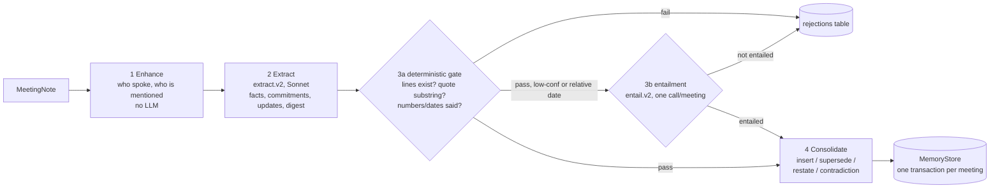
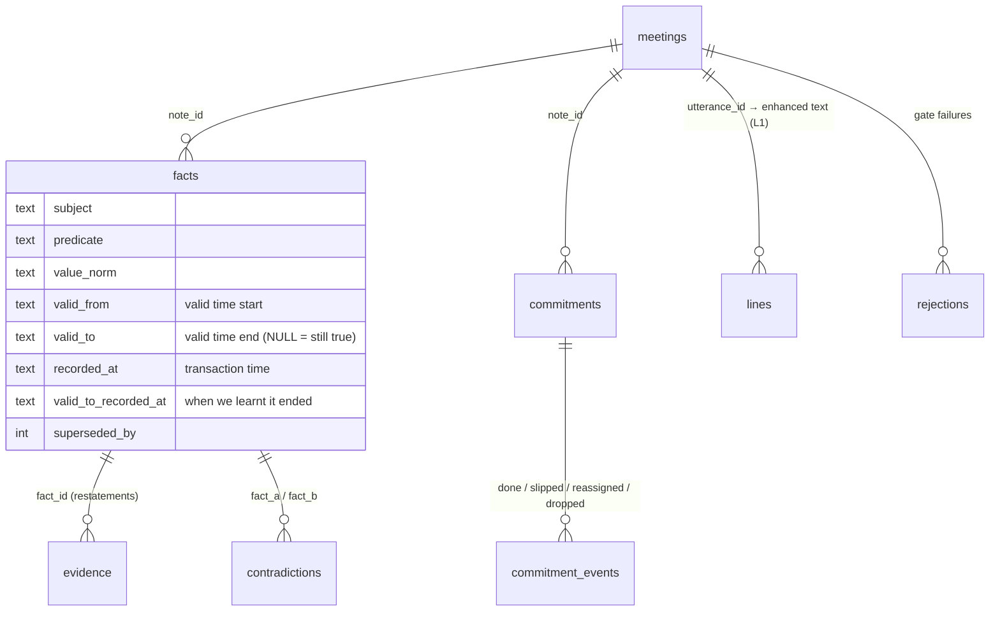
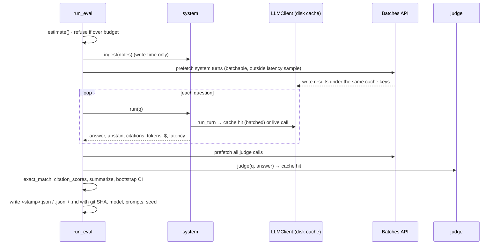

# The whole system in 15 minutes

This tour follows **one meeting** from Granola to a number on a results page. At each stop you get the
exact file and function, what it does in two or three sentences, and *why it exists*. The code
links point at `HEAD 50fefb4` (branch `feat/granola-mcp-source`). If a line has moved, search
for the function name.

Companion docs: [CONCEPTS.md](CONCEPTS.md) explains every technique named here, [EXERCISES.md](EXERCISES.md)
has hands-on drills, and [INTERVIEW_PREP.md](INTERVIEW_PREP.md) covers what to say about it.

> **One-sentence version.** We turn Granola notes into a test: a synthetic company with known
> answers. Seven systems answer the same questions with the same model and are graded by the same
> judge. Then we measure accuracy, cost and latency, and say honestly where each one breaks.

Paths below are relative to `packages/concentrate/` unless they start with `web/`, `prompts/` or `tests/`.

---

## Stop 0: Where a meeting starts (Granola)

Granola records a meeting and keeps a **note**: title, calendar event, attendees, an AI summary,
the owner's typed notes, and a **transcript** split into short items. Each transcript item carries
`speaker.source`: `"microphone"` (the note owner, "Me") or `"speaker"` (system audio,
everyone else, "Them"). Names and diarization labels are optional and often missing. There are
two ways in:
- the **REST API**, which needs a Business/Enterprise plan;
- the **official MCP server**, which works on any plan and returns agent-oriented text.

Every field we rely on is tagged VERIFIED or ASSUMED in [`docs/SCHEMA_NOTES.md`](../SCHEMA_NOTES.md).

**Why it matters:** the whole benchmark is shaped by what Granola *actually* gives you. There's no
audio, no per-word confidence, and the speaker is often unknown. We model only that.

## Stop 1: The Source boundary

| What | Where |
|---|---|
| The protocol every source implements | [`sources/base.py:29`](../../packages/concentrate/sources/base.py#L29) `Source` |
| REST API client | [`sources/granola_api.py:56`](../../packages/concentrate/sources/granola_api.py#L56) `GranolaAPISource`, request core `_get` at [`:113`](../../packages/concentrate/sources/granola_api.py#L113), `get_note` at [`:177`](../../packages/concentrate/sources/granola_api.py#L177) |
| Rate limiter | [`sources/ratelimit.py:69`](../../packages/concentrate/sources/ratelimit.py#L69) `RateLimiter` |
| Official MCP client (read-only) | [`sources/granola_mcp.py:155`](../../packages/concentrate/sources/granola_mcp.py#L155) `GranolaMCPSource`, `get_note` at [`:233`](../../packages/concentrate/sources/granola_mcp.py#L233), `passages_to_transcript` at [`:129`](../../packages/concentrate/sources/granola_mcp.py#L129) |
| Fixtures (synthetic data) | [`sources/fixtures.py:23`](../../packages/concentrate/sources/fixtures.py#L23) `FixtureSource` |
| Wire models (exact API shapes) | [`core/granola.py`](../../packages/concentrate/core/granola.py): `Note` at `:117`, `Speaker` at `:81`, MCP variants `McpNote` at `:180` |

**What it does.** `Source` has three methods: `list_notes(updated_after=…)`, `get_note(id)` and
`list_folders()`. All three return Granola's *wire* shapes, validated by Pydantic.
- `GranolaAPISource._get` wraps every HTTP call. It runs the rate limiter first, then retries 429,
  5xx and transport errors with full-jitter exponential backoff. On a 429 it honours `Retry-After`.
- `get_note` asks for `?include=transcript` (one request). On `413` it falls back to the paginated
  transcript endpoint. On `404` ("still processing") it retries, then raises `NoteNotReady`.
- `GranolaMCPSource` gets the same data through MCP tools. It parses their XML-ish text with lenient
  regexes and reads transcripts 10 chunks at a time.

**Why it exists.** One boundary means downstream code never knows (or imports `httpx` to find out)
whether a note came from the API, the MCP or a fixture file. The strongest test in the repo
checks exactly that: [`tests/test_sync.py:24`](../../tests/test_sync.py#L24)
`test_api_and_fixture_sources_produce_identical_stores`.

## Stop 2: Sync into the NoteStore, then normalize

| What | Where |
|---|---|
| Incremental sync | [`sources/poller.py:38`](../../packages/concentrate/sources/poller.py#L38) `sync` |
| SQLite note store | [`core/store.py:87`](../../packages/concentrate/core/store.py#L87) `NoteStore`, `upsert_note` at [`:108`](../../packages/concentrate/core/store.py#L108), `high_watermark` at [`:192`](../../packages/concentrate/core/store.py#L192) |
| Wire → normalized model | [`core/models.py:106`](../../packages/concentrate/core/models.py#L106) `normalize_note` |
| Me/Them rule | [`core/models.py:93`](../../packages/concentrate/core/models.py#L93) `channel_of` |
| Line IDs | [`core/models.py:88`](../../packages/concentrate/core/models.py#L88) `utterance_id` → `"{note_id}:{index:04d}"` |

**What it does.** `sync` asks the source for notes updated since a **watermark**: the newest
`updated_at` the *server* has shown us, minus a 10-minute overlap. Notes whose `updated_at` hasn't
changed are skipped. Notes that 404 go into a `pending_notes` table and are retried on every sync.
The store keeps the **raw wire JSON**, so normalization can change later without a re-sync.
`normalize_note` turns a wire `Note` into a `MeetingNote` of `Utterance`s, each with a stable line ID
like `not_ab12…:0037`. Those IDs are what every system cites.

**Why it exists.** Citations need stable IDs, and Granola doesn't provide utterance IDs, so we make
them from position. That's simple and readable, but **positional**: if a transcript is
re-processed, or a fixture is regenerated, line 37 becomes a different sentence. The results
explorer has to defend against exactly this (Stop 9).

### Side stop: where the test meetings come from (`synth`)

The benchmark company, Northwind, is generated **world first, text second**.
[`synth/scenario.py:235`](../../packages/concentrate/synth/scenario.py#L235) `build_world(seed)`
plans people, prices, launch dates and commitments, each with an outcome. Meetings are rendered
from that world, with every fact tied to the exact lines that state it. Questions come from the
world ([`synth/questions.py:699`](../../packages/concentrate/synth/questions.py#L699) `generate`),
and [`synth/questions.py:738`](../../packages/concentrate/synth/questions.py#L738) `validate` checks
that every gold answer's evidence really appears in its gold lines. Filler speech comes from
[`synth/filler.py`](../../packages/concentrate/synth/filler.py) (v2: template-composed, fact-free,
but naming real projects so it acts as a retrieval distractor). The orchestrator is
[`synth/pipeline.py:107`](../../packages/concentrate/synth/pipeline.py#L107) `generate_dataset`.

**Why:** hand-labelling 228k words is impossible to do well. Planting the facts first means every
answer is known by construction. Same seed gives byte-identical files
([`tests/test_synth.py:37`](../../tests/test_synth.py#L37)), and the committed fixture must equal a
fresh `synth --seed 42` ([`tests/test_synth.py:42`](../../tests/test_synth.py#L42)).

## Stop 3: The fork, query-time vs write-time

Every system implements the same small protocol ([`agents/baselines.py:124`](../../packages/concentrate/agents/baselines.py#L124)
`System`: `run(question) → SystemResult`). Write-time systems add an `ingest(notes)` step first
([`agents/baselines.py:99`](../../packages/concentrate/agents/baselines.py#L99) `WriteTimeSystem`).
All of them answer with the **same prompt** (`prompts/answer.v1.md`, `ANSWER_PROMPT` at
[`agents/baselines.py:38`](../../packages/concentrate/agents/baselines.py#L38)), the same answer schema
(`answer`, `abstain`, `citations`) and the same model (Opus 5.5). So **the only thing that differs is
what each system puts in front of the model.**

## Stop 4a: Query-time systems (b0–b3)

| System | Where | In two sentences |
|---|---|---|
| b0 top-k | [`agents/baselines.py:244`](../../packages/concentrate/agents/baselines.py#L244) `TopKSystem`, retriever at [`:218`](../../packages/concentrate/agents/baselines.py#L218) `MeetingRetriever` | Indexes every 15-line transcript chunk and every summary ([`agents/corpus.py:68`](../../packages/concentrate/agents/corpus.py#L68) `chunks`), ranks them by BM25 + embeddings fused with RRF ([`agents/retrieval.py:59`](../../packages/concentrate/agents/retrieval.py#L59) `HybridIndex`, [`:50`](../../packages/concentrate/agents/retrieval.py#L50) `rrf`), then rolls up to the top 20 *meetings*. It puts those meetings' full notes and transcripts in context: classic RAG. |
| b1 summaries | [`agents/baselines.py:279`](../../packages/concentrate/agents/baselines.py#L279) `SummariesOnlySystem` | Same retrieval, but only AI summaries and typed notes. It shows what you lose if transcripts are thrown away. The summaries are deliberately lossy (20% of points dropped), as real ones are. |
| b2 full | [`agents/baselines.py:292`](../../packages/concentrate/agents/baselines.py#L292) `FullContextSystem` | Every meeting in one **cached** system prompt. It's the "can the model just read everything?" ceiling, and fits only the small set. |
| b3 agent | [`agents/baselines.py:523`](../../packages/concentrate/agents/baselines.py#L523) `AgenticSystem`, tools at [`:419`](../../packages/concentrate/agents/baselines.py#L419) `AgentTools` | A tool-using loop whose four tools mirror Granola's live MCP: `search_meetings` (titles/summaries/notes only), `get_meetings`, `search_transcripts` (240-char passages *without speakers*), `get_meeting_transcript`. It has a 12-turn budget (`AGENT_MAX_TURNS`), and running out counts as wrong. |

**Why b3 matters most:** the live probe ([`docs/PROBE_2026-11-02.md`](../PROBE_2026-11-02.md)) showed
Granola's MCP is now an agent, so "naive top-k" is no longer the baseline to beat. b3 is our
*re-implementation of the shape*. It is not Granola's agent (see INTERVIEW_PREP Q4).

## Stop 4b: Write-time systems (b4 Mem0, b5 Graphiti)

[`agents/mem0_system.py:381`](../../packages/concentrate/agents/mem0_system.py#L381) `Mem0System` and
[`agents/graphiti_system.py:535`](../../packages/concentrate/agents/graphiti_system.py#L535) `GraphitiSystem`
feed meetings into the real open-source libraries in chunks (40 utterances for Mem0, episodes for
Graphiti), with every LLM call metered. Then they answer from what those memories return. They're
the "off-the-shelf memory" comparison. Wiring details are in [`docs/baselines/`](../baselines/).

## Stop 4c: Concentrate (system `c`): Enhance → Extract → Gate → Store

Entry point: [`agents/concentrate_system.py:183`](../../packages/concentrate/agents/concentrate_system.py#L183)
`ConcentrateSystem.ingest` walks meetings **in date order** and calls
[`memory/pipeline.py:194`](../../packages/concentrate/memory/pipeline.py#L194) `MemoryBuilder.ingest` once per meeting.

**1. Enhance (no LLM).** [`enhance/enhancer.py:25`](../../packages/concentrate/enhance/enhancer.py#L25) `enhance`
decides *who said each line* and *who/what each mention refers to*.
- Speakers: [`enhance/speakers.py:107`](../../packages/concentrate/enhance/speakers.py#L107) `SpeakerResolver`.
  - Each candidate gets a log-linear score from a prior plus cues: addressing ("Kofi, what's on your
    plate?"), self-reference, turn continuity.
  - In remote meetings, unnamed "Them" lines are solved jointly by **forward–backward** along the
    conversation ([`:253`](../../packages/concentrate/enhance/speakers.py#L253) `_remote_chain`).
  - In-person meetings with iOS diarization assign whole clusters at once ([`:437`](../../packages/concentrate/enhance/speakers.py#L437) `_diarized`).
- Mentions: [`enhance/mentions.py:222`](../../packages/concentrate/enhance/mentions.py#L222) `MentionLinker`, using
  **Jaro–Winkler** and **Double Metaphone** ([`enhance/strings.py:46`](../../packages/concentrate/enhance/strings.py#L46), [`:60`](../../packages/concentrate/enhance/strings.py#L60)),
  so "Coffee" can link to Kofi.

*Why:* the live probe found Granola's agent attributing commitments to "Unidentified speaker" and
missing a person who appeared only as an email handle. Deterministic scoring is free, explainable
and measurable against ground truth.

**2. Extract (LLM).** [`memory/extract.py:97`](../../packages/concentrate/memory/extract.py#L97) `extract_request`
builds one structured-output call per meeting (prompt `prompts/extract.v2.md`, `EXTRACT_PROMPT` at
[`:24`](../../packages/concentrate/memory/extract.py#L24)). It returns an `Extraction`
([`memory/schema.py:68`](../../packages/concentrate/memory/schema.py#L68)):
- atomic **facts** (`subject`, `predicate`, `value`, `value_norm`, `valid_from`, `source_lines`, `quote`);
- **commitments**;
- **updates** to earlier commitments;
- a short **digest**.

The prompt is given the open commitments and known keys, so a later meeting can say "the script is
done" about an earlier promise. If a meeting's reply hits `max_tokens`, it's re-extracted in
overlapping 60-line windows ([`memory/extract.py:46`](../../packages/concentrate/memory/extract.py#L46) `windows`).

**3. Gate.** [`memory/verify.py:142`](../../packages/concentrate/memory/verify.py#L142) `check_item`
rejects an item if:
- it cites no lines, or lines that aren't in this meeting;
- its `quote` isn't a normalised substring of the cited lines ([`:70`](../../packages/concentrate/memory/verify.py#L70) `quote_supported`);
- a number or date in `value_norm` is never said in those lines ([`:109`](../../packages/concentrate/memory/verify.py#L109) `check_value`). This uses
  `spoken_numbers` ([`core/spoken.py:101`](../../packages/concentrate/core/spoken.py#L101)), so "twenty five dollars" counts as 25.

Items that pass but are low-confidence (< 0.75) or use a relative date ("by Thursday") get one
batched **entailment** call ([`:206`](../../packages/concentrate/memory/verify.py#L206) `entail`,
`prompts/entail.v2.md`), and a missing verdict fails closed. Every rejection is stored with a reason.
*Why:* memory you can't trust is worse than no memory. A fact can only enter if the transcript says it.

**4. Consolidate.** [`memory/store.py:246`](../../packages/concentrate/memory/store.py#L246) `MemoryStore.add_fact`
keys facts by `(subject, predicate)` and handles a new value in one of four ways:
- **restates** the current value → add evidence, raise confidence;
- **supersedes** it → close the old row with `valid_to`, keep it;
- **contradicts** it on the same day → flag both, resolve nothing;
- is new → **insert**.

Commitments ([`:105`](../../packages/concentrate/memory/store.py#L105)) move through events, and
`status_at` ([`:117`](../../packages/concentrate/memory/store.py#L117)) reports "no follow-up"
distinctly from "done". Each meeting commits in **one SQLite transaction** with its stats and its
L0–L3 token **tiers** ([`memory/pipeline.py:329`](../../packages/concentrate/memory/pipeline.py#L329)).
So a crash can't leave a half-ingested meeting, and a rerun skips stored meetings (`has_meeting` at the top of `ingest`).

## Stop 5: Answering a question with Concentrate

[`agents/concentrate_system.py:349`](../../packages/concentrate/agents/concentrate_system.py#L349) `run` →
`_user` ([`:321`](../../packages/concentrate/agents/concentrate_system.py#L321)) →
[`memory/query.py:59`](../../packages/concentrate/memory/query.py#L59) `parse_question`, which finds the
entities and intent (as-of, latest, history, status, list), then
[`memory/query.py:149`](../../packages/concentrate/memory/query.py#L149) `build_context`. The context has four sections:
1. a **structured lookup** of every known fact about each resolved entity, filtered to
   `recorded_at ≤ as_of`;
2. **commitments** with their status as of the question date;
3. **hybrid search** over fact texts and meeting digests;
4. the **source lines** those facts cite, unless that meeting is "retired" (`retire_after_days`,
   the transcript-retirement knob).

That context goes to the same `answer.v1` call as every baseline.

**Why the as-of filter matters:** without it, a question "as of Sept 15" could see a fact recorded
on Oct 1. That's leakage from the future, and it would flatter the memory.

## Stop 6: Grading (the eval harness)

| What | Where |
|---|---|
| Orchestration | [`evals/runner.py:306`](../../packages/concentrate/evals/runner.py#L306) `run_eval` |
| Cost estimate before any spend | [`evals/runner.py:202`](../../packages/concentrate/evals/runner.py#L202) `estimate` |
| LLM judge | [`evals/scoring.py:110`](../../packages/concentrate/evals/scoring.py#L110) `judge` (prompt `prompts/judge.v1.md`) |
| Exact match | [`evals/scoring.py:50`](../../packages/concentrate/evals/scoring.py#L50) `exact_match` |
| Citation precision / recall | [`evals/scoring.py:59`](../../packages/concentrate/evals/scoring.py#L59) `citation_scores` |
| Per-system aggregation + bootstrap CI | [`evals/scoring.py:159`](../../packages/concentrate/evals/scoring.py#L159) `summarize`, [`:141`](../../packages/concentrate/evals/scoring.py#L141) `bootstrap_ci` |
| All LLM calls: cache, cost ledger | [`llm/client.py:247`](../../packages/concentrate/llm/client.py#L247) `LLMClient`, cache key [`:269`](../../packages/concentrate/llm/client.py#L269), `structured` [`:295`](../../packages/concentrate/llm/client.py#L295) |
| Batch prefetch | [`llm/client.py:765`](../../packages/concentrate/llm/client.py#L765) `prefetch_turns` |
| Retries / timeouts | [`llm/resilience.py:146`](../../packages/concentrate/llm/resilience.py#L146) `call_with_retries`, [`:61`](../../packages/concentrate/llm/resilience.py#L61) `timeout_for` |

**What it does.**
1. Write-time systems ingest first; that cost is reported separately as *ingest*.
2. Each system answers each question. In batch mode, the first 10 questions run interactively
   (they're the only latency source), and the rest are prefetched through the Message Batches API at
   50% off into the *same cache files* an interactive call would write.
3. The judge grades `correct / partially_correct / incorrect`, and only "correct" counts.
4. Exact match and citation P/R are shown alongside, so judge bias is visible.
5. `CONCENTRATE_BUDGET_USD` is checked before every question, and anything estimated over $2 asks
   first (CLAUDE.md rule).

**Why the disk cache:** every LLM call is keyed by sha256(model, prompt id, system, user, schema,
max_tokens, effort). Reruns are free, `--offline` can reproduce a report with zero API calls, and
the batch path needs no second code path.

## Stop 7: The report

`run_eval` writes three files to `evals/reports/<stamp>` ([`evals/runner.py:473`](../../packages/concentrate/evals/runner.py#L473)):
- `.json`: `meta` (date, git SHA + dirty flag, model, seed, split, prompt versions, budget, spend)
  plus per-system metrics;
- `.jsonl`: one row per (system, question);
- `.md`: human-readable, made by `to_markdown` ([`:490`](../../packages/concentrate/evals/runner.py#L490)).

The only committed report is the 10-question dev pilot `evals/reports/20261102T100403Z` (b2 100%,
b0 and b3 90%, b1 70%). It *saturated*, which is why Northwind-XL exists.

## Stop 8: Analysis (`concentrate analyze`)

[`evals/analyze.py:198`](../../packages/concentrate/evals/analyze.py#L198) `analyze` works on any saved report and costs
nothing unless `--llm`. It computes:
- paired significance for every system pair: McNemar exact test plus a paired-bootstrap CI of the
  gap, Holm-corrected ([`evals/stats.py`](../../packages/concentrate/evals/stats.py));
- **power**: how many questions are needed to detect a gap ([`evals/stats.py:115`](../../packages/concentrate/evals/stats.py#L115));
- the **cost–accuracy Pareto frontier**, with ingest amortised over a question volume
  ([`evals/pareto.py:52`](../../packages/concentrate/evals/pareto.py#L52));
- a **failure taxonomy** from ground truth: stale value, wrong entity, partial list, retrieval miss…
  ([`evals/failures.py:257`](../../packages/concentrate/evals/failures.py#L257) `classify`).

Judge reliability is checked separately: [`evals/judge_check.py`](../../packages/concentrate/evals/judge_check.py)
re-grades with a second model (Cohen's kappa at [`:82`](../../packages/concentrate/evals/judge_check.py#L82)) and
exports a blind hand-check sample.

*Why:* with 10 questions, no gap was statistically reliable. The analysis says so in its first
paragraph instead of letting a leaderboard imply a ranking.

## Stop 9: The results explorer (`web/`, `/results`)

| What | Where |
|---|---|
| Load reports straight from `evals/reports/` | [`web/lib/results.ts:285`](../../web/lib/results.ts#L285) `loadReport` |
| Green/amber/red line marks | [`web/lib/explore.ts:32`](../../web/lib/explore.ts#L32) `classifyLines` |
| Pareto front on the scatter | [`web/lib/explore.ts:134`](../../web/lib/explore.ts#L134) `paretoFront` |
| Leaderboard page | `web/app/results/[stamp]/page.tsx` |
| Question drill-down | `web/app/results/[stamp]/q/[qid]/page.tsx` |

**What it does.** It's a Next.js view over the report files. It has a leaderboard with CI whiskers,
a cost-vs-accuracy scatter, a category heatmap, and a question page with every system's answer side by
side. Clicking a citation opens the transcript at that line: green = cited and gold, amber = cited
but not gold, red dashed = gold but not cited.

**Why it re-checks fixtures:** line IDs are positional (Stop 2). Before colouring anything, the
loader recomputes citation P/R against the fixtures *at the report's git SHA* and shows a
"reproduces N/N" chip. Against today's regenerated fixtures, 18/36 pilot answers would not reproduce
([`docs/RESULTS_EXPLORER.md`](../RESULTS_EXPLORER.md)).

---

## Side branches off the main line

- **MCP server** ([`mcp_server/server.py:59`](../../packages/concentrate/mcp_server/server.py#L59) `build_server`, logic in
  [`mcp_server/service.py:82`](../../packages/concentrate/mcp_server/service.py#L82) `MemoryService`). `concentrate mcp-serve` serves a
  built memory over stdio with six read-only tools and one resource, so you can put it next to
  Granola's MCP in Claude. Doc: [`docs/MCP_SERVER.md`](../MCP_SERVER.md).
- **Pre-meeting brief** ([`memory/brief.py:245`](../../packages/concentrate/memory/brief.py#L245) `build_brief`, eval in
  [`evals/brief.py`](../../packages/concentrate/evals/brief.py)). It's an as-of query that lists open commitments and
  changes since the series last met. Memory finds 91% of open commitments vs 30% for top-k, but with
  43% precision ([`docs/BRIEF.md`](../BRIEF.md)).
- **Hardening** ([`watchdog.py`](../../packages/concentrate/watchdog.py), [`agents/progress.py:21`](../../packages/concentrate/agents/progress.py#L21) `read_progress`,
  [`llm/resilience.py`](../../packages/concentrate/llm/resilience.py)). It adds timeouts, logged retries, a
  stall watchdog that exits 75, and crash-safe resume. Doc: [`docs/HARDENING.md`](../HARDENING.md).
- **On other branches, not merged here at `50fefb4`:**
  - transcript-retirement curve (`claude/ws-c-retirement-…`, `concentrate retire-curve`);
  - real-data slice against Granola's real agent (`claude/ws-b-real-slice-…`).

## The five sentences to remember

1. **One `Source` protocol**, three implementations; downstream never knows which.
2. **Ground truth first:** Northwind is planted, so every answer and every gold line is known.
3. **Same answer model, prompt and judge for all seven systems;** only the context differs.
4. **Concentrate = deterministic enhance + LLM extraction + a grounding gate + a bitemporal store,**
   and every fact cites line IDs.
5. **Every number is reproducible** (git SHA, prompts, seed, disk cache) and **paired-tested**
   (McNemar + Holm), and the pilot honestly says "not significant".
