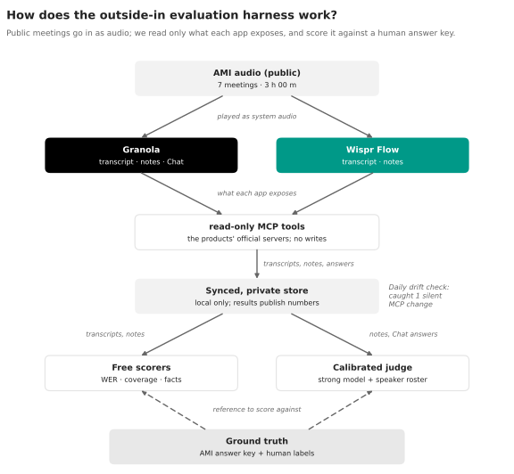

# Harness: comparing meeting products on the same meetings

This page describes TENOR's outside-in harness: how a product plugs in through its public, read-only MCP, how one meeting is paired across products, and what is and is not comparable.



Every track is product-neutral. Granola and Wispr Flow (its Notetaker) are the two reference products, chosen as the two leading bot-free meeting note-takers with public MCP access. This page covers four things:

- how a product plugs in;
- how the same meeting is paired across products;
- what is and isn't comparable;
- how to record paired meetings without leaking them.

**Status (2026-11-04):** the code is built and tested against fakes only. Nothing has been run against a live Wispr account yet, so no results exist. The Wispr response shapes are guesses, listed as ASSUMED in [SCHEMA_NOTES.md](../engineering/SCHEMA_NOTES.md#wispr-flow-mcp-concentratesourceswispr_mcp).

## How a product plugs in

A product touches the benchmark in up to three places. Each one goes only through the product's **public MCP**, and only through **read tools**.

| Interface | What it is for | Granola | Wispr Flow |
|---|---|---|---|
| **`Source`** (`tenor.sources`) | Syncing meetings into a local SQLite store, so we can draft questions, pair meetings, and build notes-faithfulness cases | `GranolaMCPSource`: `list_meetings`, `get_meetings`, `get_meeting_transcript` | `WisprMCPSource`: `search_meetings`, `get_meeting`, `get_meeting_participants_enriched` |
| **`Product`** (`tenor.blackbox`) | Question answering (black-box track) | `GranolaProduct` (its own agent, `query_granola_meetings`) **and** the outside agent | the outside agent only (Wispr has no QA tool) |
| **`NotesCase`** (`blackbox.notes_source`) | Notes faithfulness: the product's notes plus a transcript to check them against | `summary_markdown` (AI-enhanced notes) | the Flow Summary, optionally plus its `content` notes body |

**Read-only by construction.** Every caller is wrapped in `AllowlistCaller` (`tenor.sources.allowlist`). It refuses any tool outside the allowlist **before anything is sent**. Wispr's server is read-only too, according to its help centre, but we don't rely on that. Tests check the refusal for write-shaped and unknown names: `tests/test_wispr_mcp.py`, `tests/test_wispr_products.py`.

### Connecting to Wispr Flow

- **Server URL.** `WISPR_MCP_URL` defaults to `https://api.wisprflow.ai/connect/mcp`, taken from Wispr's help centre. The authoritative value is in the app under **Settings → MCP → "All other apps"**. If it differs, put it in `.env`.
- **Sign-in.** It is browser-based. We reuse Granola's OAuth client (dynamic client registration, loopback redirect). Tokens go to `~/.config/concentrate/wispr-mcp.json` (mode 600, outside the repo) and are never logged.
- **The open question.** Wispr documents a browser sign-in but not whether it accepts dynamically registered clients. If sign-in fails at the registration step, Wispr only supports its listed clients (Claude, ChatGPT, Cursor, Gemini). In that case the sync needs a different route, and nothing here should be worked around.

```bash
uv run tenor sync --source wispr-mcp --db data/real_wispr.db
```

## The standard outside agent (agent-interface track)

Granola's MCP has its own question-answering agent. Wispr's has none. Comparing Granola's agent with "nothing" would say nothing. Comparing two vendors' agents would mix model, prompt and data together. So the track holds the agent fixed and varies only the data interface (`tenor.blackbox.outside_agent`).

**Held fixed for every product:**
- the model (`LLMClient.model`);
- the prompt ([`prompts/outside_agent.v1.md`](../../prompts/outside_agent.v1.md));
- the answer schema;
- the question;
- the `ToolBudget`: 10 tool calls, 40,000 characters per tool result (the largest single read either product returns), 12 turns.

**Varies:** the product's read tools, *as its server publishes them*. That means the names, descriptions and input schemas from `tools/list`, plus whatever the tools return.

| Row | Tools the agent may call |
|---|---|
| `granola+outside-agent` | `search_meetings`, `get_meetings`, `get_meeting_transcript`, `search_transcripts` |
| `wispr+outside-agent` | `search_meetings`, `get_meeting` |
| `granola` (extra row) | Granola's own agent, `query_granola_meetings` |

A tool outside the binding is refused, and the model is told so. Once the budget runs out, further calls return "answer now". On the last turn no tools are offered at all. The trace records tool names, arguments and errors, never results.

**This is a measurement of each MCP as a data interface for an external agent.** The interface includes its tool design. For example:
- Wispr returns up to 40,000 transcript characters per call, while Granola returns up to 10 chunks per call;
- Granola can search transcripts, while Wispr's search can't.

Those differences are what the track measures, not noise.

**Not yet wired.** `open_outside_agent()` connects live, but `real-kit run` doesn't offer the outside agent as a `--product` yet. Live runs cost LLM money: estimate first, and ask before anything over $2.

## Pairing the same meeting across products

Kian records each meeting in both products at once. `tenor pair` then matches them (`tenor.blackbox.pairing`):

1. **Time gate.** Start times (calendar start, else creation) must be within **±10 minutes**. Pairs outside the window are never made automatically.
2. **Score.** A weighted mean of the signals both sides have, renormalised over the signals present:
   - **transcript similarity (0.6):** containment of word 3-grams, i.e. the share of the shorter transcript's 3-grams found in the longer one. Two speech recognisers hearing the same conversation share many exact 3-grams; different meetings share few.
   - **attendees (0.2):** Jaccard over emails, or over names when one side has no emails.
   - **title (0.2):** Jaccard over words.
3. **One-to-one.** Pairs are assigned greedily, best score first, with ties broken by ID, so the result is deterministic. Pairs scoring under **0.35** are dropped.
4. **Manual overrides win.** `data/real/pairs.override.json` holds `{"pairs": [{"a": <granola id>, "b": <wispr id>}], "never": [...]}`. Entries in `pairs` are forced; entries in `never` are blocked.

```bash
uv run tenor pair --granola-db data/real.db --wispr-db data/real_wispr.db
```

The command writes `data/real/pairs.json` (gitignored). It prints only meeting IDs, scores and counts: no titles, names or text.

**Known limits:**
- Back-to-back meetings within 10 minutes are told apart only by content.
- A meeting one product failed to transcribe is paired on title and attendees alone, which is weaker. Check those pairs by hand.

## What's comparable, and what isn't

| Comparable on paired meetings | Not comparable (report separately, or not at all) |
|---|---|
| Questions answered by the **outside agent** over each product's read tools | Granola's own agent vs. Wispr: Wispr has no agent. Granola's agent is an extra row, not a head-to-head |
| **Notes faithfulness**, with both products' notes checked against **one shared reference transcript** (`paired_cases`) | Each product's notes checked against its *own* transcript: a product whose transcript dropped a word can't be caught getting that word wrong. Report as a secondary view only |
| Transcript coverage, by aligning one product's transcript against the other's | Speaker attribution. Granola labels a capture channel (mic = Me, system audio = Them). Wispr gives speaker *names*, and our Me/Them for Wispr is inferred from the account holder's name (ASSUMED) |
| Search behaviour of each MCP, measured through the outside agent | Timestamps. Granola gives per-passage start times. Wispr's plaintext transcript may have none, in which case our utterance times are synthetic (ordered, spread over the meeting) and temporal "when in the meeting" scoring must skip Wispr |
| | Typed notes. Granola's `private_notes` are the user's own writing. Wispr's `content` is its generated notes body. Both land in `private_notes_markdown` but mean different things: never compare them as "user notes" |
| | Retention and deletion. Wispr deletes audio after 7 days by default, and transcript retention is user-set. The retention track must record each product's settings |

## Privacy

- **Where data lives.** Real meetings live only under gitignored paths: `data/real.db` (Granola), `data/real_wispr.db` (Wispr), and `data/real/` (pairs, overrides, answers, reports).
- **What gets printed.** Commands print IDs, counts and scores. The outside agent's `raw` holds the final answer and a tool trace without results, but answers can still quote meetings, so treat `data/real/answers/` as private.
- **Shared meetings.** Meetings other people shared with the account are skipped by default (`include_shared=False`). Their transcripts and private notes are withheld by sharing policy, and they aren't the user's recordings.
- **Before publishing.** Only aggregates leave `data/real/` (`write_committable`). Run `scripts/prepublish_check.py` before every push.

## How to record paired meetings (for Kian)

1. **Before the meeting.**
   - Link both apps to the same calendar, so both see the same event (same start time, title and attendees).
   - In Wispr, check that Notetaker, MCP and Cloud Sync are on.
2. **During the meeting.**
   - Start both recorders at the start of the call, so their start times land well inside ±10 minutes.
   - Record calls with audio from both sides. In-person meetings are weaker for comparison (Granola puts everyone on one microphone).
   - Tell attendees that two notetakers are running, and get their consent.
3. **After the meeting.**
   - Wait until both products have finished processing; Wispr's `finalized` flag must be true.
   - Then run both syncs:
     ```bash
     uv run tenor sync --source granola-mcp --db data/real.db
     uv run tenor sync --source wispr-mcp --db data/real_wispr.db
     uv run tenor pair
     ```
4. **Check the pairs.**
   - Look over the printed pairs.
   - Add anything the matcher missed or got wrong to `data/real/pairs.override.json`.
   - Note how many meetings ended up paired.
5. **Calibration.** On the first sync, check the ASSUMED rows in SCHEMA_NOTES.md against real responses: transcript line format, continuation marker, key names. Do it without printing meeting content, for example by counting turns, speakers and characters. Then update the table.
