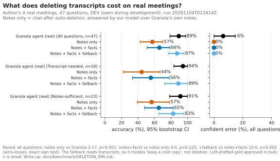

# What Does Breadth over Fidelity Cost? An Outside-In Measurement of Meeting Memory for Agents

**Kian Lakhani** · 4 November 2026 · Summary of the [full technical report](HINDSIGHT_REPORT.md) · Independent research; not affiliated with Granola

---

### Summary

Granola has chosen breadth over fidelity: its agent reads many meetings' notes rather than a few transcripts, and users may auto-delete transcripts. I measured the cost of that choice on real meetings, using only public interfaces. **With transcripts, Granola's agent answered 89% of questions; from notes alone, 57%.** The loss falls on detail questions. Adding extracted facts to the notes recovers little (66%), while **reading the transcript only when the notes fall short recovers nearly all of it (87%)**. On the same meetings, a precomputed fact memory scored 59% against Granola's agent's 92%. All of this is development-stage evidence from four meetings of one person. Synthetic data is reported only as a diagnostic, because it pointed the wrong way.

---

## 1. Question

Granola's agent reads about 100 meetings at a high level rather than 10 in full detail, goes "deeper only when needed", and treats "wrong, but confident" as the failure to avoid [3]. Transcript auto-deletion has shipped: afterwards, chat is "limited to whatever is in your notes", and Granola notes that "Chat quality will be degraded" [2]. The CEO has also described pre-compressing meeting context for agents ("apple juice from concentrate") [1].

**Question:** on real meetings, what does each level of fidelity buy back, per question type, and how do answers fail when it's missing?

## 2. Method

- **Outside-in.** Only public interfaces are used: Granola's API note format and its official read-only MCP. No claims are made about Granola internals.
- **Real meetings (black-box track).** The author's 4 Granola meetings and 47 questions. An LLM drafted the questions and gold answers, and the owner approved them in bulk. Products are asked through their public MCP; only content-free aggregates are published.
- **Systems.** Granola's agent (black box); top-k retrieval; and **Concentrate**, a reference fact memory that extracts cited, time-stamped facts. Our systems share one answer model (Opus 5.5).
- **Answer types.** Every answer is *correct*, *partial*, *declined* (abstains or says the material doesn't cover it) or *wrong but confident* (judged incorrect without hedging).
- **Statistics.** Paired exact sign tests on discordant questions, 95% bootstrap CIs, and a second model re-grading every answer.

## 3. Results (real meetings, DEV)

### 3.1 Retention: what deletion costs and what recovers it

Four conditions on the same 47 questions, each adding one layer: **(A)** Granola's agent with transcripts; **(B)** notes only, answered by our model over Granola's own notes (≈ chat after auto-deletion); **(C)** B plus the extracted fact layer; **(D)** C plus reading the transcript only when the notes and facts don't cover the question.

**Figure 1.** Accuracy by question type, and confident-error rate, for each condition.

**Table 1.** Answer types (counts of 47) and paired effect of each layer (wins–losses on discordant questions, exact sign test).

| Condition | Accuracy | Correct / partial / declined / wrong-confident | Paired vs previous | Transcript-needed (n = 18) |
|---|---|---|---|---|
| A: Granola, transcripts | 89% | 42 / 2 / 0 / 3 | — | 94% |
| B: notes only | 57% | 27 / 4 / 16 / 0 | 2–17, p = 0.001 | 44% |
| C: + fact layer | 66% | 31 / 2 / 14 / 0 | 4–0, p = 0.13 | 56% |
| D: + transcript when needed | 87% | 41 / 3 / 3 / 0 | 10–0, p = 0.002 | 89% |

### 3.2 Question answering: reading real speech

All 4 meetings fit in context, so this measures how well systems read real speech, not how well they search. Granola's agent scored **92% [82, 100]**, top-k (k = 1) 77% [64, 90], and the fact memory **59% [44, 74]** (n = 39). Paired, Granola alone was right on 14 questions and the fact memory alone on 1 (p ≈ 0.001). The fact memory had extracted 43 facts across the 4 meetings; 10 of its 16 misses were declines, and it scored **0 of 8 on "who said X"** (Granola 7 of 8). It led only on "what changed" (6 of 6 vs 5 of 6), the category a time-stamped store is designed for. A transcript fallback raised it from 12/22 to 20/22 on the questions reached before the budget cap (8–0, p = 0.008), against Granola's 19/22. These questions shaped the fallback, so this result is DEV only.

## 4. Analysis

1. **The cost of deletion falls on detail questions, and it is large.** Notes alone answered 44% of transcript-needed questions against Granola's 94%. That's the quantitative version of "chat quality will be degraded".
2. **Compression into facts does not substitute for the transcript.** The fact layer's +9 points isn't distinguishable from zero at this n, and the fact memory lost to Granola's agent by 33 points when answering on its own.
3. **Selective depth recovers the loss.** Reading the transcript only on demand restored 87% (vs 89% for Granola), with no confident errors. It fired on 60% of questions here, so on small corpora it isn't cheap. This is Granola's own "deeper only when needed" principle. **The implication is about retention, not retrieval: once transcripts are deleted, the deeper tier no longer exists.**
4. **Deletion turned right answers into declines, not bluffs.** Without transcripts, our model declined 16 of 47 and never answered wrongly with confidence. Granola's agent, with transcripts, gave the only 3 confident errors, 2 of them on unanswerable questions. Granola's own degraded chat may behave differently; this is worth measuring directly.
5. **Robustness checks.** A second judge agreed on 96–100% of verdicts per condition, and on 97% in the question-answering slice (κ 0.93), with no change in ranking.

**Synthetic diagnostic, not evidence.** On *Northwind*, a synthetic company in Granola's format (184 meetings, 120 held-out test questions), the fact memory, an agent over transcripts and top-k were statistically tied (92 / 90 / 88%), and adding facts to notes-only recovered most of the deletion loss (64% → 88%, dev). Real meetings reversed both findings. The synthetic questions are generated from planted facts, which is exactly what an extractor keeps; the same author built the generator and the extractor; v1 transcripts are heavily templated; and an oracle already scores 95%. We keep it for debugging, not for claims.

## 5. Implications

- **Retain a reachable detail tier.** Delete transcripts from hot storage if needed, but keep a cold copy that's read only when notes don't cover a question.
- **Make degradation specific.** "Who said what", exact wording and passing details are what notes lose; users enabling deletion could be told so.
- **Evaluate memory on real questions.** Synthetic benchmarks built from planted facts systematically favour extraction-based memory.

## 6. Limitations

1. **The evidence is 4 meetings from one person,** with LLM-drafted gold answers approved in bulk, and questions seen during development. It is **DEV, not a held-out test.**
2. **Condition B uses our answer model over Granola's notes,** not Granola's actual post-deletion chat, so A − B mixes deletion with a model change.
3. **4 meetings don't test search at scale;** everything fits in context.
4. **The primary judge is an LLM;** no human check has been done.

**In progress:** hand-written held-out test questions, paired Granola + Wispr Flow recordings of the same meetings, more meetings and contributors, and other meeting products through the same black-box kit.

**Code, data, figures and every number's source:** [github.com/KLKH7/hindsight](https://github.com/KLKH7/hindsight).

---

1. C. Newton, interview with Chris Pedregal, *Platformer*, 30 Jul 2026. https://www.platformer.news/granola-chris-pedregal-interview/
2. Granola Help Centre, "Transcript auto-deletion". https://docs.granola.ai/help-center/consent-security-privacy/transcript-auto-deletion
3. Granola, "How Granola thinks about designing agents", 6 May 2026. https://www.granola.ai/blog/how-granola-thinks-about-designing-agents
