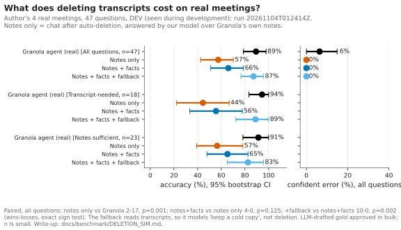
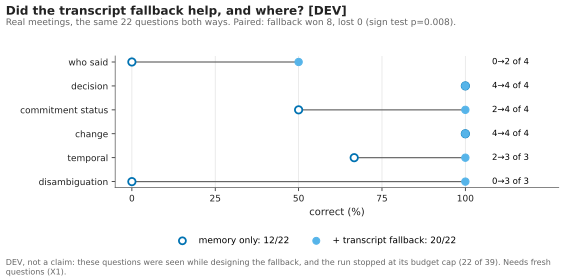

# Hindsight: What Does Breadth Over Fidelity Cost? An Outside-In Benchmark for Agent Memory over Meeting Notes

**Kian Lakhani** · Technical report · 4 November 2026 · Independent research prototype, not affiliated with Granola

## Abstract

Agents increasingly read meeting memory through MCP servers, and Granola, the meeting-notes product this work targets, has made a public trade-off: its agent reads many meetings shallowly rather than a few in detail, and users may auto-delete transcripts so that chat works from notes alone [2, 3]. We ask what that trade-off costs on **real meetings**, measured only through public interfaces. Hindsight's black-box kit asks any meeting product questions through its public MCP, on the user's own meetings, and publishes only content-free aggregates. On the author's 4 Granola meetings (all results DEV), three findings stand out. (1) **Deletion is costly, and the cost falls on detail:** with transcripts Granola's agent answered 89% of 47 questions; our model over Granola's notes alone answered 57% (paired 2–17, p = 0.001), and 44% vs 94% on questions whose answer isn't in the notes. (2) **Reaching the transcript recovers the loss; a fact layer doesn't:** adding extracted facts reached 66% (4–0, p = 0.13), while reading transcript passages only when notes and facts fall short reached 87% (10–0, p = 0.002). Without transcripts our model declined rather than bluffed: no confident wrong answers. (3) **Reading real speech, Granola's agent beat a precomputed fact memory 92% to 59%** (n = 39, paired 14–1, p ≈ 0.001). A synthetic benchmark built by the same author had shown the opposite on both points, so we report it only as a diagnostic. The main limitation is the data: 4 meetings from one person, LLM-drafted gold answers approved in bulk, and questions seen during development.

## 1. Motivation

External agents (Claude, ChatGPT) reach Granola only through its MCP. In a July 2026 interview Granola's CEO said that an agent connected to Granola through Claude can "look at the 20 most relevant meetings" and does "a relatively dumb job at extracting information", proposed sending agents "apple juice from concentrate" instead, and said Granola was "looking into whether we should delete the transcript automatically" [1]. (Our own read-only probe found the MCP has since become an agent that searches, reads and cites, so the 20-meeting description is out of date [11].) Granola's agent-design post states the trade-off explicitly: "breadth over fidelity", reading about 100 meetings at a high level rather than 10 in full, with transcripts costing roughly 10× the tokens of notes, and going deeper only when needed; the failure it most wants to avoid is "wrong, but confident" [3]. Transcript auto-deletion has shipped: afterwards chat is "limited to whatever is in your notes", and the help page warns "Chat quality will be degraded" [2]. Granola can measure this internally. What an outside benchmark adds is independence, comparability across products, and the view an external agent actually gets.

## 2. Benchmark

**Outside-in principle.** Everything is built on public interfaces (Granola's REST API format and its official, read-only MCP) [5, 12]. We make no claims about Granola internals.

**Black-box track: the source of every headline.** For products that cannot load a shared corpus (Granola included), the kit asks the product's public MCP the user's own questions, through a single allowlisted tool (`query_granola_meetings` for Granola); a wrapper refuses every other tool before anything is sent, and only content-free aggregates can be written to committable files [9]. Here the corpus is the author's 4 Granola meetings (3 remote, 1 in person). An LLM drafted 47 questions in seven categories (who said X, decisions, what changed, commitment status, which person, temporal, unanswerable) with gold answers, and the owner approved them in bulk with 0 edits [17]. Every question was seen during development, so every real result is **DEV**. Because all 4 meetings fit in a model's context, the track measures *reading real speech*, not retrieval at scale.

**Answer types.** Following Granola's own framing of the worst output as "wrong, but confident" [3], each answer is classed as *correct*, *partial*, *declined* (abstains or says the material doesn't cover it) or *wrong but confident* (judged incorrect without hedging; Granola's agent has no abstain flag, so its prose is read for hedges) [4, 10].

**Statistics.** There is no single score; [METRICS.md](../benchmark/METRICS.md) defines six dimensions: correctness, judge reliability, grounding, knowing what it doesn't know, efficiency at equal prices, and robustness [10]. Real comparisons use exact two-sided sign tests on discordant pairs and 95% bootstrap CIs (2,000 resamples); a second judge (Sonnet 5.5) re-grades every answer.

**Northwind (synthetic, diagnostic only).** A generated company in Granola's exact API JSON shape: 184 meetings, 296 questions (90 dev / 206 test) with answers known by construction, byte-identical for a given seed [5]. It is useful for debugging and for anyone who can't share meetings; §4c explains why it is not evidence of real-world performance.

## 3. Systems

On real meetings we compare **Granola's agent** (black box, live), **top-k retrieval** (k = 1 of 4 meetings, reading whole transcripts) and **Concentrate**, a write-time memory that resolves speakers and entities, extracts atomic facts that cite transcript lines, drops facts their cited lines don't entail, and stores facts with the dates they were true [13]. Concentrate is a **reference system, not a product**: it exists to show what a precomputed memory gains and loses. Our systems share one answer model (Opus 5.5) and judge. An optional *transcript fallback* lets Concentrate retrieve transcript passages when its facts don't cover a question [18]. The synthetic diagnostics add further baselines (§4c).

## 4. Results


### 4a. Retention: what deletion costs and what recovers it (real DEV, n = 47)

We cannot switch deletion on inside Granola, so we rebuild four conditions outside it, each adding one layer: **A**, Granola's agent with transcripts; **B**, our answer model over Granola's own notes for every meeting (an approximation of post-deletion chat); **C**, B plus Concentrate's facts, every transcript deleted; **D**, C plus transcript passages only when C declines [4]. B, C and D share the model and prompt; A − B therefore mixes deletion with a model and prompt change, and B sees every note, an upper bound at 4 meetings.



**Figure 1.** Accuracy by tag (notes-sufficient, transcript-needed) and confident-error rate for each condition.

**Table 1.** Run `20261104T012414Z` at `6dc2cb6`, seed 42, $6.42 [4, 19]. Answer-type counts are out of 47, derived from the aggregate's accuracy, partial, confident-error and hedged-miss shares. Tags come from a portable string-matching rule.

| Condition | Accuracy [95% CI] | Correct / partial / declined / wrong-confident | Transcript-needed (n = 18) | Paired vs previous row |
|---|---|---|---|---|
| A: Granola, transcripts kept | 89% [79, 98] | 42 / 2 / 0 / 3 | 94% | — |
| B: notes only | 57% [43, 70] | 27 / 4 / 16 / 0 | 44% | 2–17, p = 0.001 |
| C: notes + fact layer | 66% [51, 79] | 31 / 2 / 14 / 0 | 56% | 4–0, p = 0.13 |
| D: + transcript fallback | 87% [77, 96] | 41 / 3 / 3 / 0 | 89% | 10–0, p = 0.002 |

Deletion costs 32 points overall and 50 on transcript-needed questions (0–9, p = 0.004). It turned right answers into *declines*, not bluffs: B declined 16 of 47 and gave no confident wrong answer. Granola's 3 confident errors came with transcripts, 2 of them on the 6 unanswerable questions. The fact layer alone recovers little and not reliably (+9, 4–0, p = 0.13). The fallback recovers most of the gap (87% vs 89%); it fired on 60% of questions (28/47), and because it reads transcripts it models "keep a cold copy", not deletion. One result counts against our own tagging: notes-only scored only 57% even on *notes-sufficient* questions (0–8 vs Granola, p = 0.008), so either the rule over-calls sufficiency or the model under-uses the notes. Second-judge agreement was 96–100% per condition.

### 4b. Question answering: reading real speech (real DEV, n = 39)

A budget cap stopped Granola and Concentrate after 39 of the 47 questions (the 8 unrun were all 6 unanswerable and 2 temporal) [17]. Granola's agent scored 92% [82, 100], top-k 77% [64, 90] and Concentrate 59% [44, 74]; paired, Granola alone was right 14 times and Concentrate alone once (sign test p ≈ 0.001); the judges agree on 97% of verdicts (κ 0.93). Why: Concentrate kept 43 facts and 11 commitments for the 4 meetings and answers only from those, while the real questions ask about long-tail details. Ten of its 16 non-correct answers were declines ("the material doesn't mention it"), and it scored 0 of 8 on "who said X" (Granola 7 of 8), where it twice named the wrong person. It led only on "what changed" (6 of 6 vs 5 of 6), the category its time-aware store is built for. The transcript fallback took Concentrate from 12/22 to 20/22 on the questions reached before the budget cap, 8 fixed and 0 broken (p = 0.008), against Granola's 19/22 on the same questions; these questions motivated the design, so this is DEV only [18].



**Figure 2.** Concentrate with and without the transcript fallback by category on 22 real DEV questions (8 won, 0 lost).

### 4c. Synthetic diagnostics: not evidence of real-world performance

Northwind is reported for completeness, and because it failed in an instructive way. Five reasons it is not evidence: (i) the same author built the generator and Concentrate's extractor; (ii) questions are generated from planted facts, exactly what an extractor keeps; (iii) v1 is templated: 78% of transcript passages of six or more words were exact copies drawn from 69 filler sentences (v2 cuts this to 4.9%, but 54% of long passages still share their first six words, against 0.6% in real meetings) [6, 7]; (iv) an oracle reading only the gold meetings already scores 95%, leaving little room to separate systems; (v) it got the deletion question wrong: on synthetic dev questions adding facts to notes-only recovered most of the loss (64% → 88%) and deleting every transcript moved Concentrate only from 89% to 88% [20], while on real meetings facts barely helped (57% → 66%, n.s.).


**Figure 3.** The lesson. Left: synthetic test, where the same three approaches tie. Right: the author's 4 real meetings, where Granola's agent leads Concentrate 92% vs 59%.

**Table 2.** Northwind-XL v1 test split (n = 120), run `20261103T002456Z` [15, 16]. Cost re-priced at equal interactive prices [14].

| System | Accuracy [95% CI] | $/question | One-off ingest |
|---|---|---|---|
| Oracle (ceiling) | 95% [91, 98] | 0.082 | — |
| Concentrate | 92% [86, 96] | 0.040 | $4.96 |
| Agent over search + transcripts (b3) | 90% [84, 95] | 0.137 | — |
| Top-k retrieval (k = 10) | 88% [82, 94] | 0.328 | — |
| Mem0 (our wiring) | 81% [73, 88] | 0.017 | $17 |
| Graphiti (our wiring) | 72% [63, 79] | 0.029 | $70 (incl. $10.66 redone after a crash) |
| Summaries only | 71% [62, 78] | 0.017 | — |

Concentrate, the agent (b3, our re-implementation of the *shape* of Granola's agent) and top-k are tied: Concentrate and the agent split their 10 disagreements 6–4 (McNemar p = 0.75, Holm 1.0), and at n = 120 the smallest gap detectable with 80% power is about 7 points [10, 16]. A second judge changed none of Concentrate's 120 verdicts (97.3% agreement overall, κ 0.90) [14]. At equal prices Concentrate is about 3.5× cheaper per question than the agent (about 2× against an agent with prompt caching, a red-team estimate), and counting ingest it is cheaper only once a set of meetings receives more than about 50 questions [14]. The red team found the Mem0 and Graphiti gaps to be about *our wiring* (Mem0 saw 25 of its 5,292 memories per question; Graphiti was never given the summaries), that only Concentrate reads an org directory (it decided 1 of 120 questions outright), and that Concentrate was tuned on dev against the generator's templates while the baselines were not [14]. A notes-sufficiency split shows summaries-only answering **0 of 17** transcript-needed questions; **that 0/17 is close to tautological**, since the tag asks whether the summary holds the answer. The measured part is that it answered 7 of 17 confidently and wrongly (41% [18, 65]) [21].

## 5. Discussion

The real-meeting results agree with each other. As a question-answering system, a precomputed fact memory loses the long tail before the question arrives, and as a retention strategy, a fact layer recovers little of what deleting the transcript costs. In both cases what worked was *reaching the transcript when the notes or facts fell short*. That is Granola's own design principle, "go deeper only when needed" [3], applied to retention: if transcripts are deleted, the deeper tier disappears, and our evidence (DEV, n = 47) suggests that tier carries most of the accuracy on detail questions. The cheapest mitigation consistent with these results is to keep transcripts reachable on demand (for example, a cold copy read only when notes don't cover a question) and to make the "degraded" warning specific about which questions suffer: who said what, exact wording, passing details. On failure mode, our notes-only model declined rather than bluffed, but a synthetic notes-only reader produced 41% confident errors on transcript-needed questions, so this depends on the model and prompt, and Granola's own degraded chat should be measured directly. The synthetic benchmark pointed the other way on both findings because its questions are generated from the facts the generator planted, which is exactly what an extractor keeps; that is why it is now a diagnostic, not evidence.

## 6. Limitations

1. **Four real meetings, one person.** Every headline number comes from the author's own account; 39–47 questions; per-category cells of 4–8 are anecdotes.
2. **LLM-drafted, bulk-approved gold.** Real gold answers were drafted by an LLM and approved in bulk with 0 edits; at least one looks wrong, and 22 of 47 questions have at least one non-correct verdict that an owner spot-check could move.
3. **Real results are DEV, not TEST.** All real questions were seen while building Concentrate, the fallback and the tag rule; no held-out real test exists yet.
4. **Simulated notes-only uses our model.** Condition B is our answer model over Granola's notes, not Granola's actual post-deletion chat, and it sees all notes (an upper bound at 4 meetings).
5. **No search at scale.** All 4 meetings fit in context, so the real track measures reading, not retrieval.
6. **LLM judge.** The primary judge is also the answer model; a second judge measures that bias rather than removing it, and the blind human hand check has not been done.
7. **Tag rule is coarse.** The portable notes-sufficiency rule agrees with the generator reference 90% (κ 0.63) on synthetic test and misfires on paraphrased dates and generic status words.
8. **Synthetic diagnostics:** one company, one generator version (v1, templated), under-tuned baselines, and the author built both the generator and the extractor.

## 7. Next steps

(1) **The fresh real test (X1, in progress):** Granola's agent vs Concentrate with and without the fallback vs top-k on the owner's hand-written held-out questions, written after the design freeze [22]. (2) **Paired Granola + Wispr Flow recordings** of the same meetings (in progress). (3) **More meetings and contributors,** so real results stop being one person's, and enough meetings to test search. (4) **More products through the black-box kit,** since any meeting MCP can be described by a JSON spec. (5) **Synthetic upkeep:** v2/v2.1 runs and the baseline wiring and directory fixes, as diagnostics.

## 8. Reproducibility

Every eval records git SHA, model, prompt versions, seed and date; LLM calls are disk-cached, so reruns are free. Synthetic test report `evals/reports/20261103T002456Z.json` (sha256 prefix `6e5919e818fe`; git `aeafca5`, dirty; Opus 5.5; seed 42; generator `northwind-1`). Deletion-simulation aggregate `evals/reports/real-deletion-sim-dev.aggregate.json` (`6bc288f59ce8`; run at `6dc2cb6`). Real-slice snapshot `docs/figures/data/real_slice.json` (`1458a32d7155`). Figures are regenerated and checked in CI from these inputs [23].

```bash
uv sync && uv run pytest                                   # offline tests
uv run concentrate synth --seed 42 --scale xl              # regenerate Northwind-XL (deterministic, free)
uv run concentrate eval --xl --split test --estimate       # price a run before spending
uv run concentrate analyze 20261103T002456Z                # paired stats, power, cost frontier
uv run concentrate figures 20261103T002456Z                # regenerate every figure
uv run concentrate notes-vs-transcript                     # re-tag saved answers ($0)
uv run concentrate deletion-sim --quote --split dev        # exact token-counted quote, no paid calls
```

To score Granola (or any meeting MCP) on your own meetings: write questions (`real-kit add --split test` or `real-kit import-test`), then `uv run concentrate real-kit run --product granola --split test --estimate` and run without `--estimate`. Everything about your meetings stays under the gitignored `data/real/`; only a content-free aggregate can be committed [9].

## References

Web sources were verified at source on 3 November 2026 (recorded in [`FINDINGS_CHECKLIST.md`](../writeup/FINDINGS_CHECKLIST.md)); repository files are at this branch.

1. C. Newton, interview with Granola CEO Chris Pedregal, *Platformer*, 30 Jul 2026. https://www.platformer.news/granola-chris-pedregal-interview/ (accessed 2026-11-03)
2. Granola Help Centre, "Transcript auto-deletion". https://docs.granola.ai/help-center/consent-security-privacy/transcript-auto-deletion (accessed 2026-11-03)
3. Granola, "How Granola thinks about designing agents", 6 May 2026. https://www.granola.ai/blog/how-granola-thinks-about-designing-agents (accessed 2026-11-03)
4. [`docs/benchmark/DELETION_SIM.md`](../benchmark/DELETION_SIM.md): deletion simulation design and DEV results.
5. [`docs/benchmark/DESIGN.md`](../benchmark/DESIGN.md): benchmark card.
6. [`docs/benchmark/FIDELITY.md`](../benchmark/FIDELITY.md): v1 fidelity audit.
7. [`docs/benchmark/FIDELITY_V2.md`](../benchmark/FIDELITY_V2.md): v2 fidelity audit.
8. [`docs/benchmark/V2_EXTRAS.md`](../benchmark/V2_EXTRAS.md): v2.1 extras.
9. [`docs/benchmark/BLACKBOX.md`](../benchmark/BLACKBOX.md): black-box kit.
10. [`docs/benchmark/METRICS.md`](../benchmark/METRICS.md): metric and statistics definitions.
11. [`docs/archive/PROBE_2026-11-02.md`](../archive/PROBE_2026-11-02.md): read-only probe of Granola's MCP.
12. [`docs/engineering/SCHEMA_NOTES.md`](../engineering/SCHEMA_NOTES.md): Granola field provenance (VERIFIED / ASSUMED).
13. [`docs/systems/concentrate/memory.md`](../systems/concentrate/memory.md): Concentrate.
14. [`docs/results/RED_TEAM.md`](../results/RED_TEAM.md): red-team audit (R1 cost, R2 wiring, R3 directory, R6 tuning, judge audit).
15. [`evals/reports/20261103T002456Z.md`](../../evals/reports/20261103T002456Z.md): synthetic test report.
16. [`evals/reports/20261103T002456Z.analysis.md`](../../evals/reports/20261103T002456Z.analysis.md): paired significance and power.
17. [`docs/results/REAL_SLICE.md`](../results/REAL_SLICE.md): real-meeting slice.
18. [`docs/systems/concentrate/fallback.md`](../systems/concentrate/fallback.md): transcript fallback.
19. [`evals/reports/real-deletion-sim-dev.aggregate.json`](../../evals/reports/real-deletion-sim-dev.aggregate.json): deletion-simulation aggregate.
20. [`docs/results/RETIREMENT.md`](../results/RETIREMENT.md): synthetic retirement curve.
21. [`docs/results/NOTES_VS_TRANSCRIPT.md`](../results/NOTES_VS_TRANSCRIPT.md): notes-sufficient vs transcript-needed.
22. [`docs/PLAN.md`](../PLAN.md): experiment plan (X1–X8).
23. [`docs/figures/README.md`](../figures/README.md): figure inputs and CI check.
