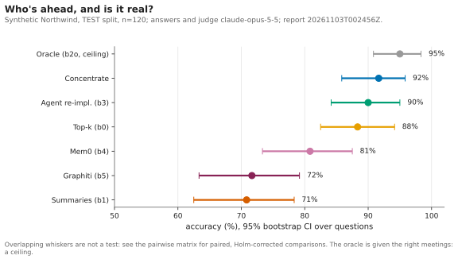
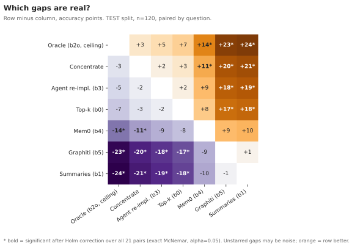
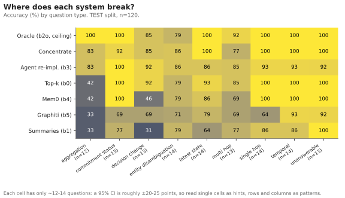
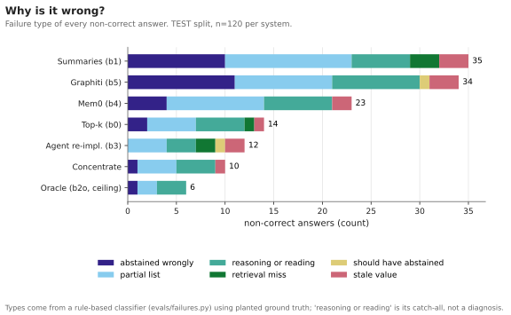
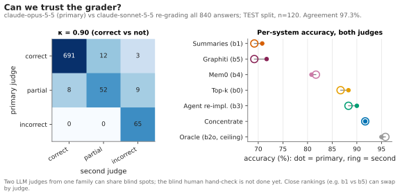
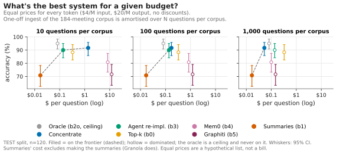
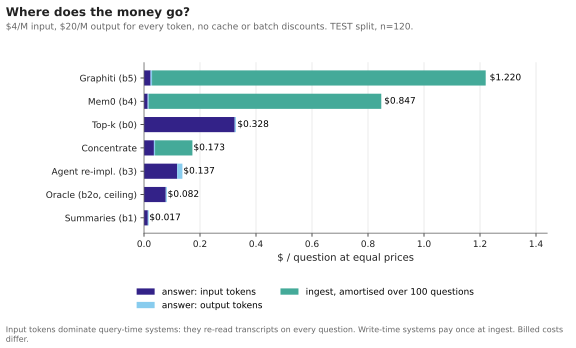
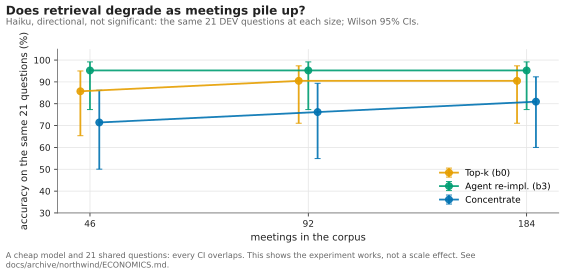
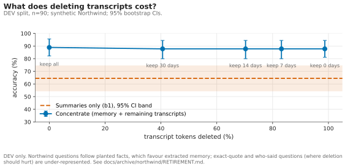
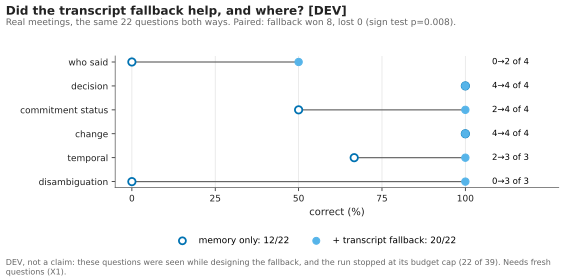

# Results index

One line per experiment: what it asks, its headline figure and the page that explains it.
Every figure is generated from saved data by `uv run concentrate figures 20261103T002456Z` and is
checked in CI (see [docs/figures/README.md](../figures/README.md) for exact inputs).

**Read the labels.** **TEST** means the held-out synthetic split (never tuned on). **DEV** means
questions that were seen while building or tuning something, so DEV results are evidence for
where to look, not claims. Dollar figures use one equal price list ($4/M input, $20/M output
tokens), not anyone's bill.

| Experiment | Question | Split | Figure | Page |
|---|---|---|---|---|
| Synthetic vs real | Why did a tie on synthetic data become a loss on real meetings? | TEST vs real DEV |  | [REAL_SLICE.md](REAL_SLICE.md) |
| Main comparison | Who's ahead, and is it real? | TEST, n=120 |  | [ANALYSIS.md](ANALYSIS.md) |
| Paired significance | Which gaps are real? | TEST, n=120 |  | [ANALYSIS.md](ANALYSIS.md) |
| By question type | Where does each system break? | TEST, n=120 |  | [ANALYSIS.md](ANALYSIS.md) |
| Failure taxonomy | Why is it wrong? | TEST, n=120 |  | [ANALYSIS.md](ANALYSIS.md) |
| Judge reliability | Can we trust the grader? | TEST, 840 answers |  | [ANALYSIS.md](ANALYSIS.md) |
| Cost frontier | What's the best system for a given budget? | TEST, n=120 |  | [ECONOMICS.md](ECONOMICS.md) |
| Cost breakdown | Where does the money go? | TEST, n=120 |  | [ECONOMICS.md](ECONOMICS.md) |
| Scale curve | Does retrieval degrade as meetings pile up? | DEV, n=21, Haiku |  | [ECONOMICS.md](ECONOMICS.md) |
| Transcript retirement | What does deleting transcripts cost? | DEV, n=90 |  | [RETIREMENT.md](RETIREMENT.md) |
| Transcript fallback | Did the hybrid help, and where? | real DEV, n=22 |  | [fallback.md](../systems/concentrate/fallback.md) |
| Pre-meeting brief | Can memory write a useful brief? | DEV / TEST | (no figure yet) | [BRIEF.md](BRIEF.md) |
| Red team | Does the headline survive attack? | all | (no figure) | [RED_TEAM.md](RED_TEAM.md) |
