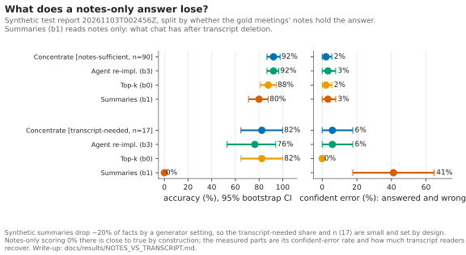

# Notes-sufficient vs transcript-needed: what a notes-only answer loses

**Question.** Granola's chat reads many meetings' *notes* and goes to transcripts only when needed, and after transcript auto-deletion chat is "limited to whatever is in your notes". So: on which questions does reading only the notes stop being enough, how often does a notes-only reader then answer **wrong but confident**, and what gets the answer back?

**Short answer (synthetic, test split, n = 17 transcript-needed questions):**
- The notes-only system (summaries, b1) got **0 of 17** transcript-needed questions right.
- It answered **7 of 17 confidently and wrongly** (41%, CI [18, 65]). It declined 7 and was partly right on 3.
- Every system that reads transcripts (top-k, our agent re-implementation b3, Concentrate) got **76–82%** of those questions right, with a confident-error rate of **0–6%**.
- On the **notes-sufficient** questions the gap shrinks to 8–12 points (n = 90), and summaries' confident-error rate is 3%, the same as the others.

So the loss from notes-only reading is concentrated in a small, identifiable set of questions, and half of it comes out as confident wrong answers rather than "I don't know".

Generated tables: [`evals/reports/notes_vs_transcript.md`](../../evals/reports/notes_vs_transcript.md) (JSON: [`.json`](../../evals/reports/notes_vs_transcript.json)). Tags: [`evals/tags/notes_tags.json`](../../evals/tags/notes_tags.json). Figure: [`notes_vs_transcript.svg`](../figures/notes_vs_transcript.svg). Everything is regenerated for $0 by:

```bash
uv run concentrate notes-vs-transcript
```

No new answers were generated. Every number is re-read from saved report rows.



## 1. The tag: computed, not hand-labelled

A question is **notes-sufficient** when its gold answer can be recovered from the *notes* of its gold meetings. Otherwise it is **transcript-needed**. Unanswerable questions are tagged separately.

The *notes* of a meeting are what a notes-only reader sees: the title, the date, the AI summary (`summary_markdown`) and the owner's typed notes (`private_notes_markdown`). The gold meetings are the meetings holding the gold evidence lines (synthetic) or the owner-approved `evidence_note_ids` (real).

There are two taggers, both deterministic, in [`evals/notes_tags.py`](../../packages/concentrate/evals/notes_tags.py):

| Tagger | Used for | How it decides |
|---|---|---|
| **Generator reference** | synthetic: the primary tag | The generator plants each fact as one summary bullet and drops about 20% of them. A question is notes-sufficient iff every planted line its answer needs survived into the notes: <br>• each fact's bullet (or the owner's typed copy of it);<br>• each commitment's task;<br>• for status questions, an update line ("Done:", "Slipped:", "Reassigned:");<br>• every person in the answer named in the notes. |
| **Portable rule** | real slice; synthetic sensitivity check | Every gold key value (synthetic `answer_norm`, real owner-listed `key_terms`) is found in the gold meetings' notes by the benchmark's own string matcher (`scoring._norm_present`). The matcher is extended with first names and status words. "Open" and "dropped" are absences of an update, so for those the rule asks instead for one of the question's evidence phrases. |

The real slice has no generator, which is why it needs the portable rule. The rule was tuned on the synthetic **dev** split only.

### How good are the taggers?

**Portable rule vs generator reference** (answerable questions; agreement and Cohen's κ):

| Set | Dev | Test |
|---|---|---|
| v1 (northwind-xl) | 94%, κ 0.80 | **90%, κ 0.63** (n = 189) |
| v2 | 92%, κ 0.69 | 85%, κ 0.48 |
| v2.1 | 89%, κ 0.66 | 86%, κ 0.59 |

- On v1 test, the rule calls 15 questions transcript-needed that the generator calls notes-sufficient, and 4 the other way.
- So the rule is **stricter**: it misses paraphrases such as "Dec 04" written for 2026-12-04.
- It also has false "sufficient" calls: a generic value like "done" can match an unrelated "Done:" bullet in the same meeting.

**Hand check.** I read 20 held-out *test* questions against their gold meetings' notes, 10 per generator tag, sampled with seed 42 by `hand_sample`. The question I asked: "could a careful reader give the gold answer from these notes alone?" This came after tuning, and nothing was changed afterwards. The verdicts are recorded in `HAND_CHECK`.

- The **generator reference agreed on 19 of 20.** The one miss is q023: the notes give the decision, but the gold answer also names who said it. I counted that as transcript-needed; the generator, which only checks `answer_norm` people, did not.
- The **portable rule agreed on 16 of 20.** Its misses:
  - q693 and q729: "done" matched a different item's "Done:" line;
  - q842: "Dec 04" was not recognised as 2026-12-04;
  - q023: the same disagreement as above.

  These are reported, not fixed, because they were found on test.

**Tag counts.**

| Set | Split | notes-sufficient | transcript-needed | unanswerable |
|---|---|---|---|---|
| v1 | test | 164 | 25 | 17 |
| v1 | dev | 67 | 15 | 8 |
| v2 | test / dev | 163 / 68 | 26 / 14 | 17 / 8 |
| v2.1 | test / dev | 183 / 76 | 41 / 22 | 17 / 8 |
| **real** (portable rule) | dev, 47 questions | 23 | **18** | 6 |

- On v1, only about 13% of answerable questions are transcript-needed. That share is a **generator setting** (`LOSSY_SUMMARY_DROP = 0.2`, plus how many facts a question needs), not a measurement of Granola.
- On the author's real meetings, the rule finds **18 of 41** answerable questions (44%) transcript-needed. Real notes leave out much more of what the owner asked about than our synthetic summaries do.
  - By real category: temporal 4/6, commitment status 4/8, who-said 3/8, decision 3/8, disambiguation 3/5, change 1/6.
  - Because the portable rule is stricter than the reference on synthetic data, 44% is probably an **overestimate**.

## 2. Confident error: a first-class metric

**Confident error** = the share of all questions a system answered (did not abstain on) *and* the judge marked **incorrect**.
- Partially correct answers don't count: they are incomplete, not wrong.
- Answering an unanswerable question does count.
- It sits beside "abstained when the answer existed" (the false-abstain count).
- It is now a column in every `concentrate analyze` report ([METRICS.md D4](../benchmark/METRICS.md#d4-confident-error-and-abstained-when-the-answer-existed)).
- Granola's agent has no abstain flag, so its value is an upper bound (≤).

Overall on the synthetic test report: Concentrate 2%, top-k 2%, oracle 1%, agent (b3) 4%, Mem0 4%, summaries 8%, Graphiti 8%.

## 3. Results

### 3a. Synthetic test report `20261103T002456Z` (generator tags)

| System | notes-sufficient (n = 90): acc · confident error | transcript-needed (n = 17): acc · confident error |
|---|---|---|
| Concentrate | 92% [87, 98] · 2% [0, 6] | 82% [65, 100] · 6% [0, 18] |
| Agent re-impl. (b3) | 92% [87, 97] · 3% [0, 8] | 76% [53, 94] · 6% [0, 18] |
| Top-k (b0) | 88% [81, 94] · 2% [0, 6] | 82% [65, 100] · 0% [0, 0] |
| Oracle (b2o, ceiling) | 96% [91, 99] · 1% [0, 3] | 88% [71, 100] · 0% |
| Mem0 (b4) | 80% · 3% | 71% · 12% |
| Graphiti (b5) | 73% · 9% | 47% · 6% |
| **Summaries (b1) = notes only** | 80% [71, 88] · 3% [0, 8] | **0%** · **41% [18, 65]** |

**Paired gaps vs summaries** (same questions; 95% paired-bootstrap CI; McNemar p):

| Transcript reader − summaries | notes-sufficient (n = 90) | transcript-needed (n = 17) |
|---|---|---|
| Top-k | +8 [+0, +16], p = 0.09 | **+82 [+65, +100]**, 14 vs 0, p < 0.001 |
| Agent (b3) | +12 [+3, +21], p = 0.01 | **+76 [+53, +94]**, 13 vs 0, p < 0.001 |
| Concentrate | +12 [+4, +20], p = 0.007 | **+82 [+65, +100]**, 14 vs 0, p < 0.001 |

The 17 transcript-needed questions cover 8 categories: latest state, commitment status and decision change (3 each), aggregation, temporal and single hop (2 each), and multi hop and entity disambiguation (1 each).

**Sensitivity: the same report with the portable-rule tags** (n = 85 / 22):
- Summaries score 27% on transcript-needed, with 27% confident error.
- The gaps to the transcript readers are +45 to +55 points (p ≤ 0.006).
- The conclusion holds. The rule's mislabels (true notes-sufficient questions sorted into transcript-needed) pull summaries' score up, which is the direction we expect.

### 3b. The retirement curve, by tag (dev, n = 90; runs `20261102T222859Z` and `20261102T224523Z`)

The two runs give identical numbers.
- **Concentrate after transcript deletion** (`concentrate@0`, which keeps the facts it extracted):
  - 80% on the 15 transcript-needed dev questions, against 87% with transcripts kept (1 question apart, p = 1.0);
  - 88% on notes-sufficient, identical with transcripts kept.
- **Summaries on the same questions:** 7% on transcript-needed, with 27% confident error.

So on synthetic data, what recovers a deleted transcript's answers is **extracting structured facts before deletion**: +73 points over notes-only on transcript-needed questions (p = 0.001). Keeping the transcript adds +7 on top, which is not significant.

### 3c. Real slice (aggregates only; portable-rule tags; dev-quality)

| Run | System | notes-sufficient (n = 23) | transcript-needed (n = 16–18) |
|---|---|---|---|
| `20261103T004019Z` | Granola's agent | 91% · conf. err ≤ 0% | 94% · ≤ 6% |
| | Concentrate | 61% · 9% | 56% · 6% |
| `20261103T013240Z` | Top-k (k = 1) | 83% · 0% | 72% · 0% |

- Granola's agent minus Concentrate: +30 [+9, +52] on notes-sufficient (p = 0.04), +38 [+12, +62] on transcript-needed (p = 0.03).
- **The real slice has no notes-only run,** so it can't show the deletion loss directly.
- What it does show:
  - On these meetings, 44% of answerable questions need more than the notes hold (by a strict rule).
  - Granola's agent stays at 94% on those questions. That fits it going "deeper" to transcripts when needed, but we can't see what it read.
  - Concentrate's real loss is spread across both tags, so it is not mainly a notes-vs-transcript problem. It is the declining problem documented in [`REAL_SLICE.md`](REAL_SLICE.md).

## 4. What this supports, and what it doesn't

**Supported:**
- On synthetic data, losing transcripts costs almost everything on the questions whose answers the notes don't hold.
- About half of that loss surfaces as confident wrong answers: 7 of 17, against at most 1 of 17 for any system that reads transcripts.
- A fact store built before deletion recovers most of it.

**Not supported, or weak:**
- **The 0% is partly true by definition.** b1 reads summaries, and the tag asks whether the summary holds the answer. The measured quantities are b1's *confident-error rate* there, and how much the transcript readers recover. Neither is fixed by construction.
- **Small n.** There are 17 synthetic transcript-needed test questions; the CIs are 30–45 points wide.
- **Synthetic summaries are generated.** The drop rate is a parameter, and each fact is one clean bullet. Real Granola notes paraphrase, merge and omit differently. That is why the real slice shows far more transcript-needed questions (44% vs 13%).
- **Tagger errors.** The generator reference was hand-checked on only 20 questions (19 agree). The portable rule, the only tagger available for real data, agrees with it 90% of the time on v1 test (κ 0.63), and is stricter.
- **b1 retrieves too.** It is top-k over summaries, so some of its notes-sufficient misses are retrieval failures, not deletion effects. On transcript-needed questions the tag already removes the answer, so retrieval doesn't matter there.
- **Real slice:** 47 LLM-drafted, owner-approved questions over 4 meetings of one person, all seen during development. There is no notes-only real run (that needs answers, so money). The upper-bound marker on Granola's agent exists because it has no abstain flag.
- **Not run on v2 / v2.1.** Their tags are counted above, but no runs exist on those sets yet (X6, X7).

## 5. Next steps (cost money)

1. A notes-only run on the real slice (b1 over Granola's own summaries) and a Granola-chat-after-deletion probe. Together these turn the real column into a direct deletion measurement.
2. Re-run on v2.1, where 18% of answerable test questions are transcript-needed, to get a larger n.
3. Fix the two portable-rule weaknesses found on test (zero-padded dates; status words matched to the wrong item), then re-check on a **fresh** sample.
