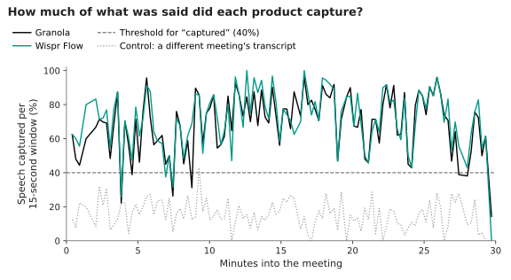

# Capture track

This page defines the capture track (did the product capture the whole meeting, and does it fail silently?) and the related typed-vs-silent test design.

| | |
|---|---|
| **Question** | Did the product capture the whole meeting, and when it did not, did it say so? |
| **How measured** | Per 15 s window of AMI's timed human words, the share of distinctive word pairs found in the product transcript; ≥ 40% counts as captured. Gaps of ≥ 30 s; silent failure = a gap with no visible warning. A wrong-meeting control calibrates the threshold. $0, no LLM |
| **Current results** | Baseline (no stress), 7 AMI meetings: Granola 98.5% of 665 windows captured (per meeting 93.6–100%), Wispr Flow 99.4% of 665 (96.4–100%). One gap flagged (Granola, EN2002b, 51 s), where Wispr Flow's coverage also dips (overlapping speech). Wrong-meeting control: 0–2% of windows pass. No silent failures |
| **Status** | Baseline preliminary; A1 audio built and run sheet ready, not run; A2–A6 and the typed-vs-silent test designed. Live detection of silent failures: [`CAPTURE_HEALTH.md`](CAPTURE_HEALTH.md) (prototype) |

Window counts are not independent (they cluster by meeting), so no pooled interval is given; the per-meeting range is the honest summary. Numbers: [`evals/reports/ami/coverage.json`](../../evals/reports/ami/coverage.json).

*Designed 2026-11-05. Two outside-in tests on AMI replays. Section A is the capture track; section B is a notes-track test that shares the replay setup.*

| Test | Question | Why it matters |
|---|---|---|
| **A. Capture reliability** | Did the product capture the whole meeting, and does it fail silently? | The most common theme in a 2026 sample of public user reports about meeting note-takers (about 16 of about 75 items, one forum, one product's user community): a recording that appeared to run but captured nothing, or notes for only some calls |
| **B. Typed vs silent** | How much do a product's notes improve when the user types a few words? | Some note-takers (Granola among them) blend the user's typing with the transcript, and a 2026 review says note quality depends on participation; all TENOR's AMI notes so far are silent replays |

---

## A. Capture reliability

**A0 result (baseline, no stress): both apps caught 94–100% of each of the 7 meetings; no silent failures.** The only flagged gap (Granola, EN2002b, 51 s near minute 27) falls where Wispr Flow dips too (overlapping speech). Stress conditions A1–A6 are where failures, if any, will show.

*Method used for A0* (`tenor ami coverage`, numbers in [`evals/reports/ami/coverage.json`](../../evals/reports/ami/coverage.json)): per 15 s window of AMI's human words, the share of distinctive word pairs found anywhere in the product transcript; ≥ 40% counts as captured. A bigram match, not the stage-1 aligner below. Wrong-meeting control: 0–2% of windows pass.

**Measures** (all $0: AMI gives timed human words, so coverage is computed by alignment, no LLM):

| Measure | Definition |
|---|---|
| **Coverage** | Share of AMI speech time (from human word timings) with matching product transcript text, via the stage-1 aligner |
| **Gaps** | Runs of ≥ 30 s of AMI speech with no aligned product text: start, length |
| **Start lag / end cut** | Time from first AMI word to first captured word; speech after the last captured word |
| **Silent failure** | A gap with **no visible warning** in the app (recorded by screenshot during the run) |
| **Bleed** | Note claims grounded in the *other* meeting (the grounding checker against both transcripts) |

**Conditions** (each a replay of a known AMI meeting; audio prepared with Python's `wave`, nothing stored beyond the public files):

| # | Condition | What it probes | Who does what |
|---|---|---|---|
| A0 | Baseline: the 7 existing recordings | Coverage under normal use | Done (re-score at $0) |
| A1 | **Long silence**: 17 min of digital silence spliced mid-meeting (A1c: 12 min, a below-timeout control) | Inactivity timeouts. At least one product documents stopping after 15 minutes without new audio (Granola help docs, undated, read 2026-11-05); Wispr Flow documents a card after about 30 s that it "isn't getting any audio", plus gap marking (help docs, read 2026-11-05). For both products: does capture resume after the timeout, and is the user told? | The author ([run sheet](#a1-run-sheet)) |
| A2 | **Back-to-back, one note**: meeting X then meeting Y with no stop | A reported failure mode: notes from one meeting written into another | Automated |
| A3 | **Back-to-back, two notes started late**: Y's note started 2 min after Y's audio begins | Missed openings; which note gets the overlap | Automated |
| A4 | **App in the background / another full-screen Space** | Capture when the app is not visible; in the 5 Nov 2026 overnight replay the replay automation lost control when the window left its desktop | Automated, screenshots |
| A5 | **Display sleep / lid closed** (`caffeinate` off) | Does capture survive sleep? | The author (a system setting the automation does not change) |
| A6 | **Network drop for 60 s** | Offline handling | The author toggles Wi-Fi |

**Comparison:** Granola and Wispr Flow side by side on every condition; same audio, same timing.

### A1 run sheet

**Audio** (built, gitignored): `uv run tenor ami stress-audio` writes `data/ami/stress/IS1008d.A1.wav` (41.7 min) and a sidecar JSON with the exact splice. IS1008d is the shortest of the 7 meetings with ≥ 10 min of voiced speech after a mid-meeting turn boundary (10.6 min). Silence runs from **12:11 to 29:11** of playback. `--condition A1c` builds the 12-min control (silence 12:11–24:11).

| # | Step |
|---|---|
| 1 | Sign in to both MCPs first: `uv run tenor sync --source granola-mcp --db data/ami_granola.db` and `... --source wispr-mcp --db data/ami_wispr.db` (read-only) |
| 2 | Normal desktop, no full-screen apps; Do Not Disturb on; speakers muted and mic per [`AMI_REPLAY.md`](../method/AMI_REPLAY.md) §3 |
| 3 | Calendar event titled exactly `AMI IS1008d A1`, no attendees, 45 min |
| 4 | Start a note for that event in Granola and in Wispr Flow |
| 5 | `caffeinate -dims afplay data/ami/stress/IS1008d.A1.wav` |
| 6 | Screenshot both apps at about 12:45 (Wispr's 30 s card), 27:15 (past Granola's 15 min), 29:30 (speech is back) and the end, plus any warning when it appears. Don't touch the apps: whether capture resumes on its own is the measurement |
| 7 | Stop both notes 30 s after playback ends |
| 8 | Sync both (step 1 commands). If a title differs, pin it in `data/ami/results/recording_ids.txt`: `IS1008d granola_a1=<id> wispr_a1=<id>` |
| 9 | Score: `uv run tenor ami coverage --stress data/ami/stress/IS1008d.A1.json` (coverage before and after the silence, resumed or not, time to resume, gaps ≥ 30 s; numbers to `evals/reports/ami/stress_A1_IS1008d.json`) |

**Cost:** $0 for A0–A6 scoring except bleed (grounding checker, ~$0.02 per meeting). Time: ~25 min of playback per condition.

---

## B. Typed vs silent

**Design:** replay the same AMI meeting twice in Granola: once **silent** (already have 7), once **typed**. In the typed run, short **cue notes** are typed at scripted moments, the way a real user jots while listening.

**The key rule: cues, not answers.** Typed text must name a topic, never the fact ("price?", "Ed: plan", "remote: TV only?"), or the notes trivially contain the answer. Cues are generated from AMI's own annotations: for each annotated decision/action, the topic words only, typed at its timestamp ± 30 s. About 6–10 cues per meeting.

| Measure | How |
|---|---|
| **Completeness** | Share of AMI's annotated decisions/actions present in the notes (grounding checker, gold-item recall) |
| **Faithfulness** | Stage 2 classes on the notes (supported / inferred / errors) |
| **Chat accuracy** | Stage 3 on the same AMI questions, calibrated judge |
| **Cue leakage check** | Every typed cue is also checked against the gold answer: if a cue contains the answer, that question is excluded |

**Meetings:** IS1008a–d and ES2006a (5 meetings, ~2 h of replay). Paired by meeting.

**Who types:** scheduled typing into the product's note body by the replay script (computer use), or the author from a printed cue sheet with timestamps. Scripted is more consistent; human is more realistic. Start scripted.

**Cost:** judging ~$0.30 (Sonnet), grounding ~$0.10.

**Threats to validity:**
- **Order and memory:** the typed run comes after the silent one; if Granola's notes ever draw on earlier meetings with the same title, results are contaminated. Mitigation: distinct titles, and check the notes cite only their own meeting.
- **Cue design is ours:** a real user types differently. Report it as "a few topic cues", not "a typical user".
- **n = 5 meetings:** report paired differences per meeting, not a single effect size.

---

## Before any run

1. **Granola paid plan:** `get_meeting_transcript` over the MCP is paid-only; the free trial covers it now. Upgrade only when the trial ends.
2. **Sign in to both MCPs first**, keep the Mac on a normal desktop (no full-screen apps), `caffeinate` on, room quiet (lessons from the 2026-11-05 overnight run).
3. Sandbox first: one condition on one meeting, check the scoring, then the rest.
