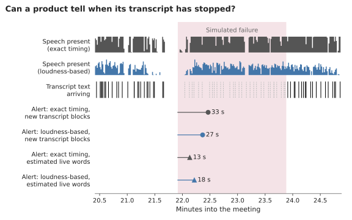

# Capture health: detecting a silent capture failure live

This page describes a product-side mechanism that flags a silent capture failure while the meeting is still running, and how TENOR measures it on AMI replays. For anyone who builds or evaluates meeting note-takers.

| | |
|---|---|
| **Question** | Can a product tell, live and without storing audio, that its transcript has stopped while people are still talking? |
| **Mechanism** | Compare two signals the product already has: is someone speaking (voice activity detection, VAD), and is the transcript growing. Speech heard but no new transcript for T seconds: alert "capture may have stopped" |
| **How measured** | 7 AMI meetings replayed into Granola. Failures injected by deleting a stretch (30 s to 5 min) of the real transcript; the coverage scorer confirms each one. Recall, detection delay, false alarms per hour on the unmodified transcripts. Tuned on DEV, reported on TEST. $0, no LLM |
| **Result (TEST, injected failures)** | Perfect VAD + live words: **237/237 caught, 0 false alarms in 2.7 h, median delay 11 s**. A plain energy VAD on recorded block times: 234/237, 1.1 false alarms per hour, 13 s |
| **Status** | Prototype; injected failures only. Not yet tested on a real failure |

Numbers: [`evals/reports/ami/detector.json`](../../evals/reports/ami/detector.json). Code: [`ami/detector.py`](../../packages/tenor/ami/detector.py), CLI `tenor ami detector --seed 0`.

## The mechanism

At each second t, raise one alert if both hold:

1. **No transcript growth** in the last T seconds.
2. **Speech heard**: the VAD found at least `min_speech × T` seconds of speech in that same stretch.

The alert re-arms when text arrives. Silence never fires it, so a long pause (stress condition A1) is not a false alarm; if capture never comes back, it fires T seconds after speech resumes.

| Part | What TENOR uses | What a product would use |
|---|---|---|
| **VAD** | `energy`: 20 ms frames, voiced if 15 dB above a causal noise floor (10th percentile of the previous 120 s) and above −60 dBFS. `oracle`: AMI's human word timings, a perfect VAD | Its own VAD on the incoming stream |
| **Transcript growth** | `block starts`: Granola's transcript block start times (recorded). `live words (est.)`: also every second a block is being spoken, estimated at 2.6 words/s (ASSUMED) | The live stream of words |
| **Clock** | One constant shift per meeting onto AMI time, from word triples unique in the meeting (67–83% of blocks match; drift under 1 s per hour) | Its own clock |

## What timing the products' transcripts give

| Product | Timing in the synced transcript | Usable here? |
|---|---|---|
| **Granola** (MCP) | Start time per block, `[m:ss]`, whole seconds, counted from the earliest block. No end time: ours is estimated | Yes (start times) |
| **Wispr Flow** (MCP) | No per-line time in any of the 7 AMI transcripts. Our parser spreads lines over the meeting by character count (gap per character identical across lines in all 7) | No: evaluated on Granola only |

Both rows are in [`SCHEMA_NOTES.md`](../engineering/SCHEMA_NOTES.md).

## How it is measured

| Step | Detail |
|---|---|
| **Split** | DEV = IS1008a (15 min), the AMI question split's DEV meeting. TEST = the other 6 (2.7 h of speech). Every parameter chosen on DEV only |
| **Ground truth** | The capture-coverage scorer ([`CAPTURE.md`](CAPTURE.md)): a failure is real when it finds an uncaptured run of ≥ 30 s |
| **Fault injection** | 40 per meeting, seeded (`--seed 0`). Length uniform in 30–300 s, start uniform within the speech. Blocks starting inside are deleted; the coverage scorer must then confirm a ≥ 30 s gap there (237 of 240 TEST faults confirmed) |
| **Recall** | Share of confirmed faults with an alert that fires by the fault's end |
| **Delay** | Alert time minus fault start |
| **False alarms** | Alerts on the *unmodified* transcripts whose silent stretch overlaps no real coverage gap, per hour of speech |
| **Tuning** | Grid: T ∈ {10, 15, 20, 30, 45, 60} s, min_speech ∈ {0.1, 0.25, 0.5}, energy margin ∈ {3, 6, 10, 15} dB. Pick: ≤ 2 false alarms/h on DEV (that is, none in 15 min), then highest recall, then shortest delay |

## Results

**TEST, 6 meetings, 2.7 h, 237 confirmed injected failures:**

| Variant (VAD + growth) | Chosen on DEV | Caught | Per-meeting recall | False alarms | Delay median / p90 |
|---|---|---|---|---|---|
| Energy + block starts | T = 15 s, min_speech 0.5 | 234/237 (98.7%) | 97–100% | 3 (1.1/h) | 13 / 27 s |
| Perfect + block starts | T = 45 s, min_speech 0.5 | 224/237 (94.5%) | 90–97% | 1 (0.4/h) | 43 / 44 s |
| Energy + live words (est.) | T = 10 s, min_speech 0.25 | 236/237 (99.6%) | 97–100% | 9 (3.4/h) | 11 / 14 s |
| Perfect + live words (est.) | T = 10 s, min_speech 0.25 | **237/237 (100%)** | 100% | **0 (0/h)** | 11 / 14 s |

DEV (IS1008a, 39 confirmed faults): 38/39 with block starts, 39/39 with live words, 0 false alarms in every variant. Windows and faults cluster by meeting, so no pooled interval is given; the per-meeting range is the honest summary. With 0 false alarms in 2.7 h, the 95% upper bound is about 1.1 per hour (rule of three).

- **Failing is easy to detect; not crying wolf is the hard part.** Every variant caught every fault of 2 minutes or more (157/157). Misses are short faults: with a perfect VAD and T = 45 s, only 12 of 24 faults of 30–60 s.
- **The false alarms come from the growth signal, not the rule.** With block starts only, natural alerts follow long blocks (29–119 words): one block start, then 17–49 s of speech with no new start while the text is in fact growing. Spreading each block over its speaking time removes them for the perfect VAD (0 in 2.7 h).
- **The energy VAD adds false alarms.** It agrees with AMI's word timings on 97.5% of the seconds it calls speech, but hears only 70% of speech seconds (TEST, margin 15 dB). With live words its alarms rise to 3.4/h: it fires on sound that holds no words (laughter, noise). A trained VAD would likely do better; untested.
- **Picking T on one 15-minute DEV meeting is fragile.** The perfect-VAD + block-starts variant chose T = 45 s because of a single DEV alarm. On TEST (reported, never used for selection), T = 20–30 s would have given 100% recall at 0.4–0.75 false alarms/h. Full table: `test_by_t_not_used_for_selection` in the JSON.
- **The one real gap was not flagged, correctly.** The baseline's 51 s Granola gap (EN2002b) drew no alert in any variant: Granola kept writing text there (overlapping speech, misheard), so its transcript was growing. This mechanism detects stopped capture, not misrecognition.
- **Stable across seeds.** Seed 1 (not committed): TEST recall within 2 points of seed 0 for every variant; false alarms identical (they do not depend on the seed).

## Limitations

- **Injected failures are not real ones.** Deleting transcript blocks mimics a stall downstream of audio (recognition, upload, sync). A failure in audio capture itself (lost permission, wrong device, digital silence) silences the VAD too, and this rule then stays quiet. Detecting that needs a signal outside the failing path, for example long runs of exact digital zeros, or the operating system reporting a call in progress.
- **Clean replay audio flatters the energy VAD.** AMI's headset mix played digitally has a low, steady noise floor. Real calls add compression, noise suppression and music.
- **Timestamps stand in for the live stream.** A product sees words as they arrive; TENOR sees only Granola's recorded block start times (1 s resolution) and an estimate of when each block was spoken. Recognition latency is not modelled.
- **Small DEV, modest TEST.** DEV is one 15-minute meeting; TEST is 2.7 h from 6 meetings, 5 of them role-play from about 2005. False-alarm rates below about 1 per hour cannot be resolved.
- **One product.** Wispr Flow's synced transcripts carry no timing, so it is not evaluated.
- **No user test.** Whether an alert helps, or annoys, is not measured here ([`IMPLICATIONS.md`](../product/IMPLICATIONS.md#1-capture-health-indicator-and-silent-failure-detection)).

## Next

Run stress condition A1 ([`CAPTURE.md`](CAPTURE.md#a1-run-sheet)) and replay this detector on its Granola transcript: the first test against a failure the product produced itself, if it produces one.
