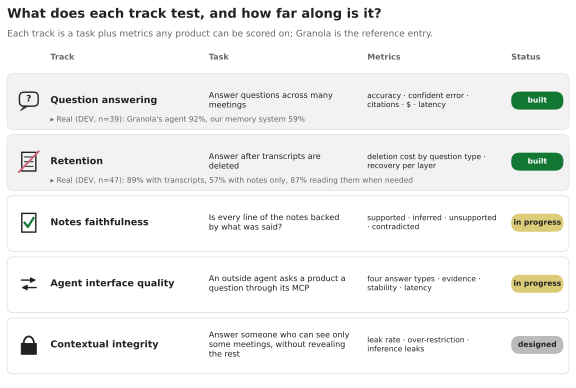

# Tracks

The index of TENOR's tracks. Each track is a question users depend on, measured the same way for every product; each page gives the question, how it is measured, current results and status.

Products: Granola and Wispr Flow, the two reference products. Meetings: 7 AMI recordings replayed into both ([`AMI_REPLAY.md`](../method/AMI_REPLAY.md)), unless a row says otherwise. Status labels: **preliminary** (small n, method still changing), **confirmed** (method frozen, n adequate, human-checked), **designed** (not run).

| Track | Question | Main measure | Status | Page |
|---|---|---|---|---|
| Capture | Was the whole meeting captured, and does capture fail silently? | Share of 15 s windows of AMI speech found in the product transcript; gaps; silent failures | Baseline preliminary; stress conditions designed | [`CAPTURE.md`](CAPTURE.md) |
| Capture health | Can a product detect, live, that its transcript stopped while people still talk? | Recall, delay and false alarms per hour of a speech-vs-transcript-growth rule, on injected failures | Prototype (Granola, injected failures) | [`CAPTURE_HEALTH.md`](CAPTURE_HEALTH.md) |
| Transcription | Are the words, numbers and names right? | WER and content-word recall against AMI's manual transcript; fact-token recall | Pilot only (1 meeting) | [`TRANSCRIPTION.md`](TRANSCRIPTION.md) |
| Notes | Are the notes faithful and complete? | Per-claim grounding against the product's and AMI's transcripts; human-checked sample | Preliminary | [`NOTES.md`](NOTES.md) |
| Answers (Chat) | Are answers about the meeting right? | Calibrated judge against AMI-derived questions; human-checked sample | Preliminary | [`ANSWERS.md`](ANSWERS.md) |
| Retention | What is lost when transcripts are deleted? | Accuracy ladder: product with transcripts, notes only, notes plus kept layers | Earlier study on 4 private meetings; AMI replication built, not run | [`RETENTION.md`](RETENTION.md) |
| Agent interface and MCP drift | What does an outside agent receive through the product's MCP, and does its shape change without notice? | Answer types, evidence granularity, stability, latency; shape diff against a baseline | Preliminary (Granola, earlier private meetings); drift check runs on Granola | [`AGENT_INTERFACE.md`](AGENT_INTERFACE.md) |

The figure above predates the AMI replay and shows the tracks as they stood on 4 November 2026; the table is current.
